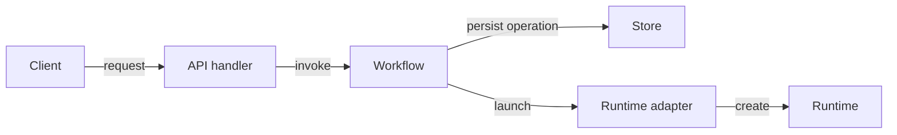

# Create GitHub pull requests

Give reviewers a concise explanation of the problem, the resulting behavior, and why the change works. Use Mermaid to show how the relevant pieces work together, with diagrams collapsed by default.

## Scope and authorization

- Distinguish preparing PR text from opening a GitHub PR, including a draft PR. Open one only when the user explicitly requests it or explicitly approves it. A request to fix an issue or prepare work against upstream does not authorize opening a PR.
- Honor authorization already given in the conversation; do not ask again after an explicit request to open the PR. If approval is still needed, finish the reviewable title, body, and target branch before asking.
- Never include enterprise issue or PR links, repository-qualified references, or identifying numbers in upstream PR titles, bodies, comments, diagrams, or closing keywords. Describe the problem independently.

## Ground the description in the change

Read applicable repository instructions and PR templates. Establish the intended repository, base, and head; inspect the complete branch diff against the base, relevant code and callers, and actual validation results. Distinguish committed changes from uncommitted work so the description matches what the PR will contain.

Use the available `eitan-voice` skill when writing on Eitan's behalf. Keep the body direct and conversational: lead with the concrete problem and resulting behavior, then explain the mechanism or tradeoff that a reviewer needs to understand. A before/after example helps when the trigger is not obvious. Include relevant checks that actually ran. Do not invent testing or narrate every changed file.

In PR descriptions and completion messages, omit lists or caveats about verification that was skipped, unavailable, or blocked by the local environment. Do not imply those checks passed. Report concrete defects, meaningful failed checks, or blockers that require action; avoid routine accounts of verification attempts.

Follow repository title conventions and required templates. Otherwise use a concrete action in the title and only enough structure to help the reader. When scope changes, rewrite the title and body around the final implementation.

## Explain interactions with collapsed Mermaid

Default to including a diagram when the change involves component interactions, data flow, or lifecycle behavior. Trace the actual flow before drawing it. For a trivial edit with no meaningful interaction to explain, omit the diagram unless the user asks for one.

- Show the smallest relevant set of components and boundaries. Label arrows with the operation or data they carry; a list of modified files connected by arrows is not an explanation.
- Use a flowchart for relationships or data flow, a sequence diagram when ordering or calls and responses matter, and a state diagram when transitions are the point. Include retries, failures, or before/after views when they explain this change.
- Represent the final implementation accurately, including relevant unchanged context. Distinguish proposed behavior from implemented behavior. Do not invent edges, transaction boundaries, or ownership.
- Keep the problem, resulting behavior, essential caveats, and validation visible outside the collapsed block. The PR must make sense without opening the diagram.
- Wrap each diagram in `<details>` with a descriptive `<summary>`. Omit the `open` attribute so it starts collapsed. Preserve blank lines around the fenced `mermaid` block and before `</details>`; keep the fence unindented. Use ordinary Mermaid syntax supported by GitHub, simple node IDs, and quoted flowchart labels containing punctuation.
- Prefer readable labels and a small diagram over custom colors, themes, or styling. Do not rely on color alone to explain the change.

Illustrative formatting; replace these components and edges with the actual flow:

````markdown
<details>
<summary>How a request reaches the runtime</summary>



</details>
````

Check syntax and every edge against the code. Use an available Mermaid preview or renderer when useful; do not claim GitHub rendering was verified from a raw Markdown check. Do not create a test PR just to preview formatting.

GitHub documents [collapsed sections](https://docs.github.com/en/get-started/writing-on-github/working-with-advanced-formatting/organizing-information-with-collapsed-sections) and [Mermaid diagrams in PRs](https://docs.github.com/en/get-started/writing-on-github/working-with-advanced-formatting/creating-diagrams).

## Prepare and open

When only drafting or preparing, return the proposed title and body or a local Markdown file. Do not publish it.

When opening is authorized:

1. Check whether a PR already exists for the intended head and base before creating one. Reuse it within the requested scope instead of creating a duplicate.
2. Ensure the intended changes and relevant checks are ready. Preserve unrelated local work. If a commit is needed within the authorized task, sign it off with `git commit -s`. Push the intended branch as needed; do not force-push or broaden the change just to open the PR.
3. Save the exact body as UTF-8 Markdown under `$TMPDIR`. Use a structured API body or `gh pr create --body-file` so backticks, newlines, and Mermaid fences survive unchanged. With `gh`, specify the repository, base, head, and title explicitly; respect requested draft or ready status.
4. If creation returns an ambiguous failure, check whether the PR was created before retrying. Stop and report an unresolved failure rather than repeatedly attempting mutations.
5. Read back the created PR and verify its title, body, target branches, and draft status. Return its URL.
