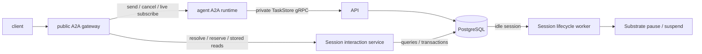

# A2A Gateway

The public gateway implements the upstream A2A handler for message send/stream,
task get/list/cancel, and subscription. It also serves the extended Agent Card
compiled into the Agent's latest successful revision (or the pinned revision of a shared conversation).

## Routing and execution

The public endpoint is a named `Agent`. HTTP selects it through
`/agents/{namespace}/{name}`; gRPC uses the standard A2A `tenant` field,
`namespace/name`. A nonempty HTTP request tenant must agree with its URL.
Actor addresses and runtime credentials remain internal.

Agent selection belongs to the transport boundary. The HTTP adapter binds the
URL's Agent after JSON-RPC decoding, while the gRPC SDK reads the request tenant.
Both supply the same SDK routing metadata to the gateway; Session and task
routing do not depend on which transport carried the request.

`Session.id` is the public A2A `contextId`. A send with no context or task ID
creates a conversation from that Agent. A context ID continues the corresponding
session. A task ID alone resolves its session; if both IDs are present they must
agree. Every operation verifies that the session belongs to the endpoint's Agent
and that the caller owns it or holds an appropriate session share. A share cannot
create conversations. A session whose Agent runs on a Harness other than
the `kagent` runtime (`claude`, `codex` or `byo`) cannot be shared at all:
`CreateSessionShare` refuses it with `FailedPrecondition`, because code one
sender's turn leaves in the runtime (a repository hook, a build target) would run
under the next sender's credentials. Reads, sends and shares that already exist are unchanged. Task-only get, cancel, and subscribe use globally unique task
IDs. ListTasks without a context lists only authorized conversations of that Agent;
a share restricts the list to its own conversation. Authorization precedes totals
and pagination. Card discovery does not create a session.

The gateway resolves the transport's Agent route and owns actor communication:
send, cancel, live subscription, connection cleanup, and response recovery. The
Session `InteractionService` owns authorization, Session resolution, dispatch
reservations, and persisted task reads. It receives the selected Agent explicitly
and verifies Session membership before returning a target or task. It has no actor
client. These operations form the persistence boundary for a separate API service.

The service prepares a send by creating or resolving its Session and reserving a
dispatch, or returning the task for an already accepted initial message. The gateway
forwards the reservation to the actor and asks the service to release it afterward.
The store enforces acceptance and revocation atomically; no database lock is held
across an actor call. Cancellation and subscription preparation return an authorized
Session target and stored task. The gateway serves terminal cancellations and
quiescent subscriptions from storage without contacting the actor.

Ownership and share policy stay private to the services; callers never select
authorization verbs. Result recovery uses the original operation's permissions.
Shared listings are restricted to one conversation and denied Sessions are filtered
before pagination. Public Agent Card URLs and SDK transport handling belong to the
gateway.

The runtime owns execution and persists updates through the private gRPC
`TaskStoreService`. The gateway owns each caller's observation connection.
Disconnecting a client or gateway does not cancel the native runner or remove
its persistence writer. Public authentication and authorization stay in the
API services; the runtime SDK serializes execution and continues waiting tasks.

## Durable ordering

The SDK creates a task through CreateTask and applies versioned UpdateTask saves.
Native work waits for the initial active task save, so lifecycle operations cannot
miss an execution that has already started. Immutable storage mutation receipts
allow lost save responses to be retried without duplicating history. Both SDKs persist intermediate updates
before streaming them. Public task history remains synthesized from the retained
messages and artifacts; this is not an exact replay archive of every wire event.

The final waiting or terminal save is staged until native cleanup is complete.
The runtime acknowledges that exact version, and the store publishes task state
and history in one transaction. Clients can read completion even when runtime
pause/suspend is slow, unavailable, or has not started. TaskStore performs no
runtime lifecycle calls and runs no background workers.

An independent Session lifecycle worker pauses waiting actors or suspends
terminal ones and records their matching snapshot. A new turn can supersede idle
work that has not been claimed. Once claimed, pause/suspend blocks new execution,
explicit lifecycle changes, and checkpoint capture until its outcome is recorded.
The gateway obtains a dispatch reservation from the interaction service before forwarding input. A reservation
blocks idle work, checkpoint capture, and explicit lifecycle operations until the
runtime saves an active task. Continuations may first save input while waiting;
the reservation stays held until their active save. Each attempt expires after two
minutes, and late first saves are rejected before native work. This timeout never
transfers permission to execute running native work.

The interaction service waits up to ten seconds for a claimed idle operation before forwarding.
A rejected send carries A2A `ErrorInfo.metadata.reason=KAGENT_SEND_NOT_ACCEPTED`
(and `retryAfterMs=100`) only if no dispatch occurred, or the unused attempt was
atomically revoked and its input was never persisted. Clients may retry that
response with the same message. They must not blindly retry transport errors.
Persistence and revocation serialize on the session; an ambiguous outcome stays
an error, and previously accepted input is recovered only from its own saved task.
Uncertain issued work remains claimed; it cannot safely be reassigned just because
a timeout expires. It blocks new execution but never hides completed task results.

Substrate's router resumes a suspended Actor on the gateway's dial and refuses
the request once its parking budget is spent. While another operation holds the
Actor, such as a repoint onto a newer template, every resume in that budget is
answered `Aborted`, and the operation may outlast it; while the worker pool
rolls, a resume is answered `ResourceExhausted` (no free worker) or `Unavailable`
(a departing worker cut it short, the Actor is back at its snapshot) for as long
as the roll takes. An Actor whose worker went away under its suspend or
resume is `CRASHED` with its last durable snapshot intact, and Substrate
returns it to that snapshot on the next resume, answering `Unavailable` while
it does. A send the runtime refused without taking its input, on a runtime
that is not lost (a missing Actor, or one crashed without a snapshot to return
to; the [lifecycle workflow](runtime-and-lifecycle.md)), therefore makes the
gateway resume the Actor itself, waiting while ate-api gives one of those
answers (backoff from 500 ms to 5 s, at most two minutes), and run the send
once more. A crashed Actor whose resume Substrate refuses (`FailedPrecondition`,
the Actor still crashed: a crash on a live worker, which Substrate does not
recover from) is lost at that resume: the session records the loss as it would
for a missing Actor, the send ends with it, and later sends are refused with it
without a dial. A session that holds no task is the exception: its runtime kept
nothing, so the wait reverts its crashed Actor to the snapshot it started from
and resumes it once more, and only a second crash is the loss; a
conversation's first send survives a golden restore whose runtime never came
up. Any other answer, or an Actor Substrate still cannot resume at
the bound, keeps the retryable refusal. The gateway waits once per turn, and
holds no dispatch reservation while it waits. An explicit `ResumeSession` waits
the same way within its attempt.

Checkpoint readiness is separate from task completion. Creating a checkpoint
requires `expected_head_task_id`, the terminal task the caller intends to capture.
The store checks that boundary atomically. `FailedPrecondition` includes a
`google.rpc.ErrorInfo` in domain `kagent.dev`: `KAGENT_CHECKPOINT_SNAPSHOT_PENDING`
permits retry with the same request and task IDs; `KAGENT_CHECKPOINT_CONVERSATION_ADVANCED`
requires refreshing the conversation and choosing a new boundary. The UI retries
only the pending reason, for at most 30 seconds. A checkpoint reservation
blocks both new turns and idle lifecycle work while the snapshot is retained.

The persistence model enforces:

- one non-quiescent task per session history;
- task-ID uniqueness and optimistic version checks;
- idempotent retries of the same storage mutation; and
- an exact snapshot identity and history sequence for each checkpoint.

Tasks contain current materialized A2A state. Complete message history is rebuilt
from ordered event rows, not stored as one history blob.

Actor communication is implemented in
[`go/core/internal/a2agateway`](../../go/core/internal/a2agateway). Authorization and
persistence operations live in
[`go/core/internal/service/session`](../../go/core/internal/service/session).

## Runtime SDK adapters

Go uses the SDK's local execution manager. The runtime executor's call interceptor
admits one send at a time and frees that slot before it settles the boundary, so
a client that sees a terminal task can send again at once. The SDK's own
`MaxExecutions` limiter is not used: it frees its slot only after settlement.
Cancellation uses its separate path, so it remains available while work runs.
The SDK's cluster workqueue is not enabled: with a single execution slot, that
queue also rejects cancellation while work is running.

Python (minimum SDK 1.1.5) uses the SDK's request queues and an `asyncio.Lock` to
serialize native work across tasks in one actor. Busy requests are rejected at
the handler; simultaneous requests that passed that check serialize at the lock.
Its `save(task)` adapter tracks expected versions per request and chooses ordinary
CreateTask or UpdateTask. Cancellation refreshes its version when it takes over
the SDK writer, after any in-flight execution save. Waiting task state is copied before the SDK mutates its
cache, preserving the original question for native approval/input validation.

Both adapters persist an initial active event before native work, stop execution
on persistence failure, and wait for native cleanup before settling a boundary.
Go uses the SDK cleanup callback; Python withholds the final event until its native
runner returns. Snapshot work runs independently after publication.
Substrate self-suspend is planned. Moving suspension into the runtime after native
cleanup and final persistence may remove the API-side worker and settlement
handoff. Current Go ADK cancellation and SDK-generated failures can save final
state before cleanup, so `SettleTask` remains until those ordering guarantees hold.

SDK upgrades must run the real gRPC/PostgreSQL fixtures covering failed saves,
cancellation, continuation, disconnects, and slow subscribers.

## Reconnect and client behavior

Get/List serve committed state without waking the runtime. Subscribe returns
current stored state for quiescent tasks; otherwise the runtime supplies its
initial task followed by live updates. If completion races subscription setup,
the gateway recovers the committed public result through the interaction service. Unary sends also recover the
task containing the input if suspension interrupts the response; ambiguous message
IDs and protocol errors are not recovered. Cancellation recovers only a terminal
task. A send whose stream breaks after the runtime took its input, while the
task is still submitted or working, first asks whether its Actor crashed. A
crashed Actor saves nothing more for the turn, whether or not it comes back,
so the turn ends `FAILED` at once rather than waiting for a boundary that never
comes. A missing Actor, or one crashed without a snapshot to return to, is a
lost runtime: the turn ends with the loss's message, the session records the
loss, and the send is answered with it. A crashed Actor Substrate returns to
its snapshot ends the turn with the crash's message, the session stays `READY`,
the send is answered with the ended turn, and the next send resumes the Actor
from its snapshot. Substrate marks the Actor crashed only once it notices the
worker is gone, so an Actor still `RUNNING` is asked about again, every second
for at most 15 seconds. An Actor that has not crashed by then, or whose state
cannot be read, keeps the turn, which the stalled-turn sweep ends if the
runtime records nothing more for it. An
interrupted request with unfinished work
still returns an error. Clients can replace their
projection with that current task and apply subsequent upstream A2A updates.
There is no event cursor or promise of replaying every previous token event.
For an initial send with neither context nor task ID, the authenticated creator,
Agent, and message ID form the creation retry key. Repeating that request reuses
the conversation. Dispatch checks its persisted input under the session lock;
an accepted message returns its task (or subscribes to ongoing work) without a
second execution. A retry may still fail while creation or lifecycle work is in
progress; keep the same message ID to retry it. A new message ID starts a new
conversation. Continuation sends do not gain this guarantee: once context/task IDs
are known, use GetTask or SubscribeToTask after an ambiguous response. Storage RPC
retries remain internal to the runtime adapter and have a separate guarantee.

The scheduler records its single dispatch attempt before sending. After an
uncertain send it only looks for the task in stored history; it never sends again.
A crash between claiming and sending can therefore leave an execution unresolved
until its deadline, when normal timeout cleanup runs.

Codex and Claude reserve their native session while approval/input is pending.
Their local executor interceptor rejects input for another task before SDK
execution. Other harnesses retain their existing policy for parked tasks. All harnesses permit at most one active execution.

## Runtime authority and deployment prerequisite

TaskStore currently uses a temporary unsigned
`x-kagent-insecure-runtime-identity` header carrying the projected atespace, actor
name, and UID. Go and Python reread those files on every call so restored actors
use their own identity. The API checks the requested session, atespace, and
recorded actor UID; user and share credentials do not grant private persistence
access. Public authentication remains unchanged.

This is the single prerelease path, with no configuration switch. The header can
be forged and does not establish verified actor identity. These builds are for
isolated deployments until [Substrate #1660](https://github.com/agent-substrate/substrate/issues/1660)
supplies actor JWT injection. That implementation will replace the header path
outright, including trusted issuer/JWKS, signature, audience, and expiry validation;
there will be no fallback to unsigned headers.

## Push notifications

See [A2A push notifications](a2a-push-notifications.md) for setup, callback
behavior, delivery guarantees, and receiver responsibilities.
