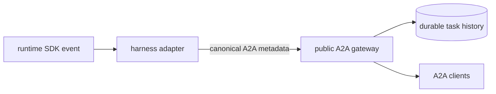

# A2A Metadata

A2A metadata extends the protocol; it does not replace it. Kagent uses native
A2A fields whenever possible and adds metadata only
for semantics missing from the pinned A2A version.

Public kagent-owned keys use the `kagent.dev/a2a/<name>` namespace. Each key has
one meaning, an explicit owner, and defined carriers.

## Ownership

Runtime adapters own knowledge of their SDK. They translate harness-specific
metadata to the small set of runtime semantics that Kagent exposes and vice-versa.
Remaining SDK-specific metadata is discarded. A new runtime must do the same.

The gateway owns routing, trust-boundary checks, persistence, and the metadata
derived from those responsibilities. It removes caller-supplied values for
gateway-owned fields before setting them itself. Otherwise, it relays canonical
runtime metadata and preserves application or negotiated extension metadata.

Consumers should read only native A2A fields and the canonical Kagent keys.
They should not interpret runtime-specific metadata.

## Current contract

| Key                                   | Carrier             | Meaning                                                                                              |
| ------------------------------------- | ------------------- | ---------------------------------------------------------------------------------------------------- |
| `kagent.dev/a2a/timeline-position`    | message or artifact | Temporary RFC 3339 timestamp used to order task history until the upstream A2A timeline is available |
| `kagent.dev/a2a/task-created-at`      | task                | Durable task creation RFC 3339 timestamp used by task projections                                    |
| `kagent.dev/a2a/part-type`            | data part           | Semantic data kind                                                                                   |
| `kagent.dev/a2a/usage`                | task event          | Model usage reported by runtimes that support it                                                     |
| `kagent.dev/a2a/output-schema-sha256` | result part         | Binds a structured result to the compiled output schema                                              |
| `kagent.dev/a2a/thought`              | text part           | Boolean that indicates model reasoning rather than its answer                                        |

The `kagent.dev/a2a/part-type` key identifies a data part's semantic type.
Supported values depend on the harness adapter:

* The Go ADK adapter recognizes `function_call` and `function_response` for
  function calls and responses.
* The Python ADK adapter recognizes `executable_code` and
  `code_execution_result` for code-execution results and executable code.

Timeline positions are written at the boundary producing an item: the gateway
for inbound messages and runtime adapters for outbound messages and artifacts.
The gateway remains responsible for applying the resulting durable order.

## Other metadata

Versioned A2A extensions, such as the [human-in-the-loop](human-in-the-loop.md)
and [token usage](usage-extension.md) extensions, keep their URI as the metadata
key.

Unknown application metadata is currently preserved. A future gateway
allowlist can narrow what crosses the public boundary without changing the
ownership rule: adapters translate runtime internals, while the gateway
enforces the public contract.
