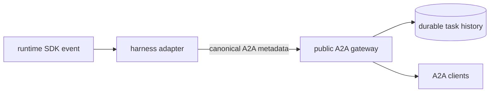

# A2A Metadata

A2A metadata extends the protocol; it does not replace it. Kagent uses native
A2A fields whenever possible and adds metadata only
for semantics missing from the pinned A2A version.

Public kagent-owned keys use the `kagent.dev/a2a/<name>` namespace. Each key has
one meaning, an explicit owner, and defined carriers.

## Ownership

Runtime adapters own knowledge of their SDK. They translate harness-specific
metadata to the small set of runtime semantics that Kagent exposes and vice-versa.
Remaining SDK-specific metadata is discarded. A new runtime must do the same.

The gateway owns routing, trust-boundary checks, persistence, and the metadata
derived from those responsibilities. It removes caller-supplied values for
gateway-owned fields before setting them itself. Otherwise, it relays canonical
runtime metadata and preserves application or negotiated extension metadata.

Consumers should read only native A2A fields and the canonical Kagent keys.
They should not interpret runtime-specific metadata.

## Current contract

| Key                                   | Carrier             | Meaning                                                                          |
| ------------------------------------- | ------------------- | -------------------------------------------------------------------------------- |
| `kagent.dev/a2a/produced-at`          | message or artifact | Supported wall-clock timestamp for the message or artifact                       |
| `kagent.dev/a2a/timeline-position`    | message or artifact | Ordering key scheduled for retirement after migration to the native A2A timeline |
| `kagent.dev/a2a/task-created-at`      | task                | Durable task creation RFC 3339 timestamp used by task projections                |
| `kagent.dev/a2a/part-type`            | data part           | Semantic data kind                                                               |
| `kagent.dev/a2a/usage`                | task event          | Model usage reported by runtimes that support it                                 |
| `kagent.dev/a2a/output-schema-sha256` | result part         | Binds a structured result to the compiled output schema                          |
| `kagent.dev/a2a/thought`              | text part           | Boolean that indicates model reasoning rather than its answer                    |

The `kagent.dev/a2a/part-type` key identifies a data part's semantic type.
Supported values depend on the harness adapter:

- The Go ADK adapter recognizes `function_call` and `function_response` for
  function calls and responses.
- The Python ADK adapter recognizes `executable_code` and
  `code_execution_result` for code-execution results and executable code.

### Item timestamps

`kagent.dev/a2a/produced-at` is a UTC RFC 3339 timestamp with fractional
seconds when available. Its source depends on the producer.

- The gateway uses acceptance time for inbound messages. Control-plane status
  messages use the corresponding status time.
- The Go ADK harness uses the ADK event time for artifacts and falls back to
  the adapter clock when the event has no timestamp. Status messages use the
  status timestamp when available.
- Claude tool artifacts use the timestamp of the envelope containing the tool
  request or result. The driver uses receipt time if the envelope timestamp is
  absent or invalid.
- Codex tool artifacts use the app server's `startedAtMs` or `completedAtMs`
  notification timestamp when present.
- The shared Claude and Codex adapter uses its emission time for items without
  a supplied timestamp. Text artifacts are stamped on their first chunk.

To measure elapsed time between tool events, match the `function_call` and
`function_response` parts by tool call ID and subtract the timestamps on their
artifacts. The interval can include approval waits and other runtime overhead.
Older records and runtimes outside this contract, including Python BYO, may
omit `produced-at`.

`kagent.dev/a2a/timeline-position` is deprecated and will be retired once kagent
and its clients migrate to native A2A timeline ordering. During the transition,
clients should use `produced-at` for time and continue using
`timeline-position` for ordering. On older Go ADK artifacts, clients can fall
back to `timeline-position` for the event time.

## Other metadata

Versioned A2A extensions, such as the [human-in-the-loop](human-in-the-loop.md)
and [token usage](usage-extension.md) extensions, keep their URI as the metadata
key.

Unknown application metadata is currently preserved. A future gateway
allowlist can narrow what crosses the public boundary without changing the
ownership rule: adapters translate runtime internals, while the gateway
enforces the public contract.
