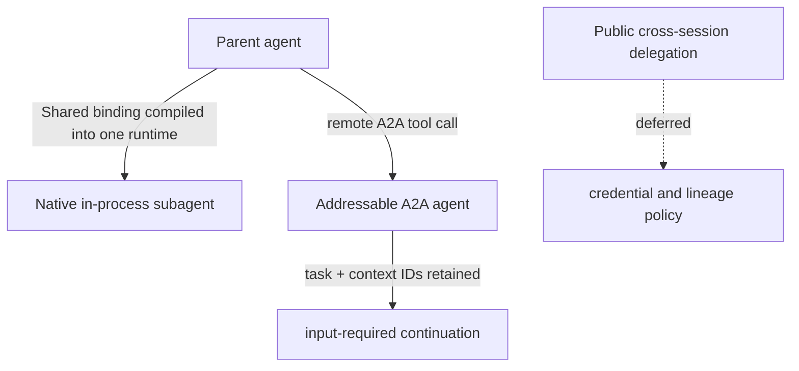

# A2A Agent Tools

Kagent has two distinct subagent mechanisms. They should not be confused.



## Shared agent tools

An `AgentTemplate` can bind another template as a Shared tool through `spec.tools[].subAgent.templateRef`. The
translator resolves the referenced template in the same compilation tree and
the selected harness compiler emits its native, in-process representation.
Kagent, Codex, and Claude support Shared bindings according to their runtime
capabilities.

For example, in an AgentTemplate spec (or an Agent's inline
`spec.template.inline`):

```yaml
tools:
  - subAgent:
      name: reviewer
      description: Review proposed changes before applying them.
      templateRef:
        name: review-context
```

Tree resolution detects missing references and cycles before compilation.

### Skills and MCP tools in native Shared agents

Claude Shared children can select standalone `spec.skills` and MCP bindings.
Their MCP servers are compiled as inline `mcpServers` in the child's `--agents`
entry, with selected MCP tools in `tools`. Child servers use the same credential
forwarding, egress, provenance, and approval handling as root servers, without
adding them to the root's MCP configuration. Skills are installed alongside root
skills and preloaded through the child's `skills` entry.
Explicit tool selections require current server discovery. The compiler also
emits `disallowedTools` for discovered tools outside the selection because the
pinned Claude CLI otherwise adds all inline MCP tools despite `tools`.

Codex installs the root's and all direct Shared children's standalone skills in
the same Codex home. Each child's role file disables every installed skill it
did not select, including root and sibling skills, using `skills.config` entries
with `enabled = false`. Codex Shared children still cannot select MCP tools:
roles cannot add servers or reduce the root's inherited MCP servers.

On both CLIs, the root can discover and invoke skills selected by a child.
Claude's `skills` field controls preloading; it does not prevent invoking other
installed skills through the Skill tool. Shared children already share the
root's runtime, sandbox, and egress policy, so these selections are not an
authority boundary. Identical skill names may share an identical source;
conflicting sources are rejected rather than overwriting one another. Child
plugins and nested Shared children remain unsupported on both native harnesses.

## Dedicated agent tools

Dedicated bindings would select an independently configured Agent with its own
Harness and Session, invoked over A2A. This execution path is deferred. The
`agentRef` field is commented out in the source and absent from the served API;
subagent bindings currently require `templateRef`.

## Runtime remote A2A tools

The Go and Python ADKs also contain a remote A2A tool. Each call sends an A2A
message to an already-addressable remote agent and preserves the child task and
context IDs. If the child enters `input-required`, the parent can retain those
identifiers and continue the same child task after receiving human input.

Implementations:

- [`go/adk/pkg/tools/remote_a2a_tool.go`](../../go/adk/pkg/tools/remote_a2a_tool.go)
- [`python/packages/kagent-adk/src/kagent/adk/_remote_a2a_tool.py`](../../python/packages/kagent-adk/src/kagent/adk/_remote_a2a_tool.py)

This runtime helper is not public cross-Session delegation. Gateway-level
delegation still requires scoped credentials, lineage/depth/cycle enforcement,
and streamed child execution; that work remains deferred.
