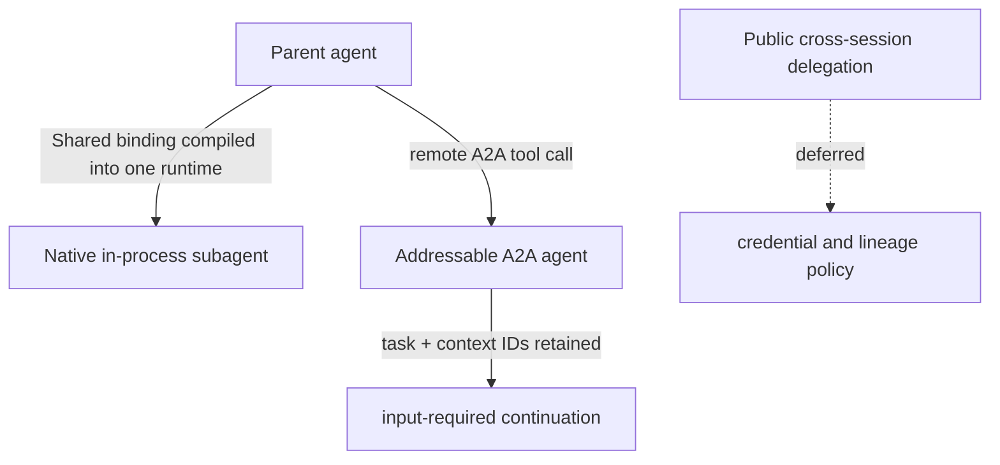

# A2A Agent Tools

Kagent has two distinct subagent mechanisms. They should not be confused.



## Shared agent tools

An `AgentTemplate` can bind another template as a Shared tool through `spec.tools[].subAgent.templateRef`. The
translator resolves the referenced template in the same compilation tree and
the selected harness compiler emits its native, in-process representation.
Kagent, Codex, and Claude support Shared bindings according to their runtime
capabilities.

For example, in an AgentTemplate spec (or an Agent's inline
`spec.template.inline`):

```yaml
tools:
  - subAgent:
      name: reviewer
      description: Review proposed changes before applying them.
      templateRef:
        name: review-context
```

Tree resolution detects missing references and cycles before compilation.

### Session isolation

By default a subagent shares the parent's Session: the parent transfers control
and the subagent answers in the same conversation history. `isolation: Isolated`
on the binding changes the call model. The parent calls the subagent as a tool and
receives its answer, and every call runs in a new conversation seeded with a copy
of the parent's state:

```yaml
tools:
  - subAgent:
      name: reviewer
      description: Review proposed changes before applying them.
      isolation: Isolated
      templateRef:
        name: review-context
```

| | `Shared` (default) | `Isolated` |
| --- | --- | --- |
| Call model | The parent transfers the conversation | The parent calls a tool and gets a result |
| History the subagent sees | The whole conversation | Only the request it was given |
| Parallel calls | Share one conversation | One conversation each |
| State | Shared | A copy; writes are not copied back |
| Human input and approvals | Reach the person through the parent | Not possible |

Use `Isolated` to fan out to the same subagent in parallel, to keep a long parent
conversation out of the subagent's context, or to keep the subagent from seeing
what the parent was told. The copy of the parent's state is what the subagent
starts from, so do not keep values there that it should not see.

The controller rejects an `Isolated` binding that cannot work, with
`Compatible=False`:

- Only the kagent and BYO Harnesses support it. Codex and Claude do not.
- The subagent's MCP bindings cannot set `requireApproval`, and it is not offered
  `ask_user`: its conversation ends with the tool call, so a request for a person
  would never be answered.
- It cannot be combined with STS token exchange. The exchanged token is cached by
  session ID and an isolated subagent runs in a new session, so its MCP requests
  would carry the caller's own credential instead. Plain token propagation works,
  because the credential travels with the request.

A subagent that is not isolated keeps its previous behavior and its revisions do
not change. The same distinction exists for declarative workflows as
`sub_agents` and `agent_tools`; see
[Declarative workflow agents](workflow-agents.md#session-isolation).

## Dedicated agent tools

Dedicated bindings would select an independently configured Agent with its own
Harness and Session, invoked over A2A. This execution path is deferred. The
`agentRef` field is commented out in the source and absent from the served API;
subagent bindings currently require `templateRef`.

## Runtime remote A2A tools

The Go and Python ADKs also contain a remote A2A tool. Each call sends an A2A
message to an already-addressable remote agent and preserves the child task and
context IDs. If the child enters `input-required`, the parent can retain those
identifiers and continue the same child task after receiving human input.

Implementations:

- [`go/adk/pkg/tools/remote_a2a_tool.go`](../../go/adk/pkg/tools/remote_a2a_tool.go)
- [`python/packages/kagent-adk/src/kagent/adk/_remote_a2a_tool.py`](../../python/packages/kagent-adk/src/kagent/adk/_remote_a2a_tool.py)

This runtime helper is not public cross-Session delegation. Gateway-level
delegation still requires scoped credentials, lineage/depth/cycle enforcement,
and streamed child execution; that work remains deferred.
