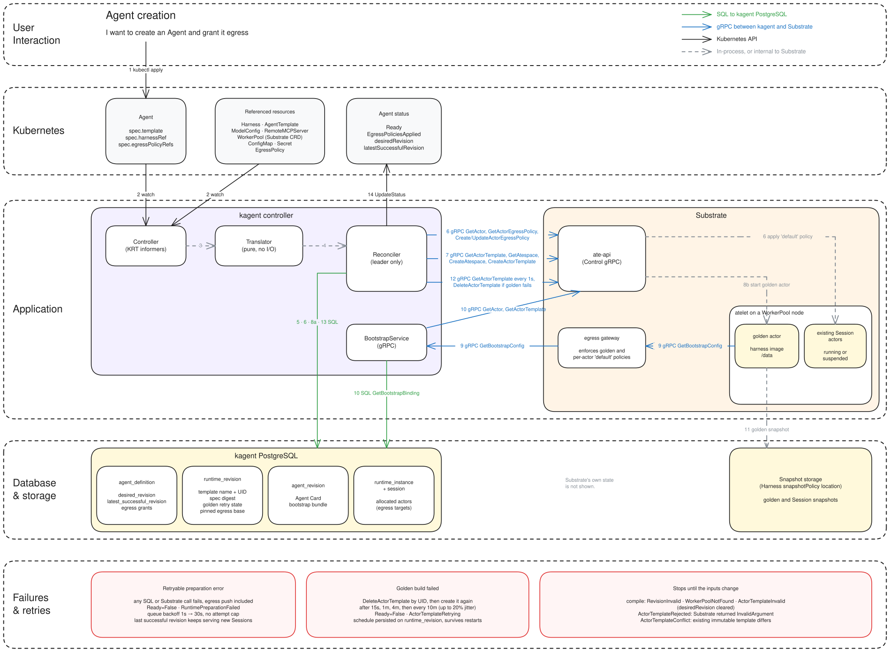

# Creating an Agent

This document traces how the control plane prepares a newly applied Agent, from
`kubectl apply` until the Agent reaches `Ready=True`.
[Failures and recovery](#failures-and-recovery) explains what happens when a step
fails.

## Reading the diagram

Numbers on the arrows match the [steps](#steps) below. Steps 8a and 8b
run at the same time. Every gRPC arrow names the RPCs it carries.

| Arrow | Meaning |
| --- | --- |
| Green, solid | SQL to kagent PostgreSQL. Only kagent reads and writes this database. |
| Blue, solid | gRPC between kagent and Substrate, in either direction. |
| Black, solid | Kubernetes API: apply, watch, and status updates. |
| Grey, dashed | In-process work inside kagent, or work internal to Substrate. |

Substrate's own state is not shown.

## Steps

| # | Kind | What happens |
| --- | --- | --- |
| 1 | Kubernetes | The user applies the Agent and any EgressPolicy it selects. |
| 2 | Kubernetes | KRT informers observe the Agent and every resource it references. |
| 3 | In-process | The translator resolves the template tree and WorkerPool, then selects the harness compiler. It performs no I/O. |
| 4 | In-process | The translator produces the immutable revision, its SHA-256 digest, the bootstrap bundle, and the desired ActorTemplate. Egress grants are resolved separately and are not part of the digest. |
| 5 | SQL | `UpsertAgentDefinition` stores `desired_revision` and the egress grants before any compute exists. |
| 6 | SQL + gRPC | The controller pushes egress to existing actors. SQL `ListRuntimeEgressSourceTargets` lists them. For each actor, gRPC `GetActor` and `GetActorEgressPolicy` read the current state, SQL `GetRuntimeEgressPolicy` combines the pinned base with current grants, and gRPC `CreateActorEgressPolicy` or `UpdateActorEgressPolicy` applies the result. Up to 16 actors are processed in parallel, and unchanged policies are skipped. When an Agent is first created it has no Session actors, so this step finds nothing to do. |
| 7 | gRPC | `GetActorTemplate` finds no template, so the controller calls `GetAtespace`, `CreateAtespace` if the Atespace is missing, and `CreateActorTemplate` with the name `<agent>-<digest>`. The template carries the golden actor's egress policy: the golden actor can make HTTP(S) requests only to the kagent control-plane URL, and the egress gateway adds a `kagent-bootstrap` actor JWT to each one. Session actors use the policy from step 6 instead. |
| 8a | SQL | `RecordRuntimeRevision` records the revision, the template UID, and the bootstrap bundle in one transaction. BootstrapService serves a bundle only to an actor whose template matches this UID and spec digest, so step 10 cannot succeed until this commits. Substrate assigns the UID in step 7, so it cannot be recorded earlier. |
| 8b | Substrate | At the same time, Substrate starts the golden actor as soon as the template exists. |
| 9 | gRPC | The template holds only a small descriptor: the control-plane URL, revision, format version, and bundle digest. The compiled configuration and Agent Card stay in PostgreSQL, so the golden actor fetches them with `GetBootstrapConfig`, and the golden snapshot and every Session started from it contain them. The call goes through the egress gateway, which adds the actor JWT, and retries while the binding is pending, until step 8a has committed. |
| 10 | gRPC + SQL | BootstrapService verifies the caller with ate-api (`GetActor`, `GetActorTemplate`), then reads the bundle with SQL `GetBootstrapBinding`. |
| 11 | Substrate | The actor saves the bundle under `/data/kagent/bootstrap` and passes `/readyz`. Substrate then snapshots and tags the template. |
| 12 | gRPC | While the golden snapshot is pending, the controller re-runs steps 5 to 7 every second and reads golden status with `GetActorTemplate`. |
| 13 | SQL | `RecordRuntimeRevision` marks the revision ready and sets `latest_successful_revision`. |
| 14 | Kubernetes | The controller updates status to `Ready=True`, replacing `ActorTemplatePending`, and sets `EgressPoliciesApplied`. New Sessions can now use the revision. |

The controller entry points are
[`controller/reconciler.go`](../../go/core/internal/controller/reconciler.go) for
steps 5, 7, 8a, 12, and 13, and
[`controller/egress.go`](../../go/core/internal/controller/egress.go) for step 6.
BootstrapService is in
[`service/bootstrap/service.go`](../../go/core/internal/service/bootstrap/service.go).

## Failures and recovery

A failed preparation does not affect existing Sessions. The last successful
revision keeps serving new Sessions until a new revision is ready.

### Retryable errors

Any SQL or Substrate call can fail, including the egress push in step 6. The
Agent reports `Ready=False` with reason `RuntimePreparationFailed`, and the
controller requeues it with a backoff from 1s to 30s and no attempt limit.

### Golden build failures

If Substrate reports that the golden snapshot failed, the controller deletes the
ActorTemplate by UID with `DeleteActorTemplate` and creates it again after 15s,
1m, 4m, and then every 10m, with up to 20% jitter. Until then the Agent reports
`Ready=False` with reason `ActorTemplateRetrying`. The schedule is stored on
`runtime_revision`, so it survives controller restarts.

### Errors that need a change

These failures are not retried until the Agent or its inputs change:

- Compilation fails with `RevisionInvalid`, `WorkerPoolNotFound`, or
  `ActorTemplateInvalid`. This also clears `desiredRevision`.
- Substrate rejects the template with `InvalidArgument`
  (`ActorTemplateRejected`).
- An existing immutable template differs (`ActorTemplateConflict`).

See [Configuration and compilation](configuration-and-compilation.md#prepared-revision-pipeline)
for revision and retry semantics, and
[Egress policies](egress-policies.md#preparation-and-lifecycle) for grant status.

## Related behavior

- Editing an EgressPolicy or its Secret re-runs only steps 5 and 6. It never
  creates a revision or a golden snapshot.
- Grant errors set `EgressPoliciesApplied=False` with reason
  `EgressPolicyNotFound`, `InvalidEgressPolicy`, or `EgressGrantConflict`. They
  never block `Ready`.
- New Session actors receive the same effective egress policy before they first
  run.
- Step 11 and the egress gateway are described from kagent's side of the
  contract, not from Substrate's implementation.
