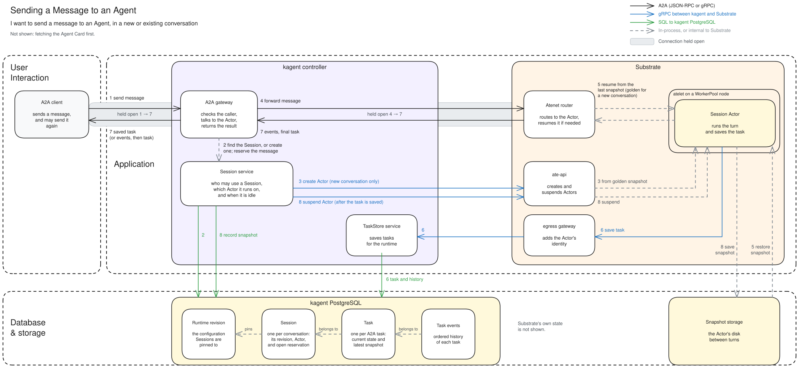

# Sending a Message to an Agent

This document explains which component is responsible for each part of sending
a message to a ready Agent, and why the components interact the way they do.
Use it to decide where a change belongs. The
[A2A gateway](a2a-gateway.md) and [Runtime and lifecycle](runtime-and-lifecycle.md)
documents describe the behavior in detail.

## Phases

Numbers on the arrows match these phases. A grey band marks a connection that
stays open across the phases it names.

1. **Send.** The client sends a message to the Agent's A2A endpoint. The
   gateway checks the caller.
2. **Find the Session.** The Session service finds the conversation, or creates
   one pinned to the Agent's latest successful revision, and reserves the
   message.
3. **Create the Actor.** New conversations only. ate-api creates the Session's
   Actor from the golden snapshot. It starts suspended.
4. **Forward.** The gateway sends the message to the Actor through the Atenet
   router and keeps the connection open.
5. **Resume.** The router resumes the Actor from its latest snapshot.
6. **Run and save.** The runtime runs the turn and saves the task through
   TaskStore.
7. **Reply.** The gateway returns the saved task, or streams events and then
   the task, and releases the reservation.
8. **Suspend.** Once the task is saved, the Session service suspends the idle
   Actor and records the snapshot on the task.

### New and existing conversations

A follow-up message uses the same components. Only three phases differ:

| Phase | New conversation | Existing conversation |
| --- | --- | --- |
| 2. Find the Session | Creates a Session pinned to the Agent's latest successful revision | Finds the Session by `contextId` or `taskId`, and checks that the caller owns it or holds a share |
| 3. Create the Actor | ate-api creates the Actor from the golden snapshot | Skipped |
| 5. Resume | Resumes from the golden snapshot | Resumes from the snapshot recorded after the previous turn |

## Responsibilities

| Component | Responsible for | Not responsible for |
| --- | --- | --- |
| A2A gateway | The public endpoint: checking the caller, talking to the Actor, and returning the result | Saving tasks, or Session state |
| Session service | Who may use a Session, which Actor it runs on, reserving messages, and suspending idle Actors | Sending messages to the Actor |
| TaskStore service | Saving tasks and history for the runtime | Running the agent |
| Atenet router | Routing to the Actor and resuming it when a message arrives | Knowing what a Session is |
| ate-api | Creating and suspending Actors | Deciding when to suspend |
| egress gateway | Adding the Actor's identity to its requests | Deciding what is allowed |
| Session Actor | Running the turn and saving the task | Authorization |

## What kagent stores

| Record | Holds | Why |
| --- | --- | --- |
| Runtime revision (`runtime_revision`) | The configuration a Session runs | A Session is pinned to one revision, so editing the Agent changes a running conversation only through its egress grants. |
| Session (`runtime_instance`, `session`) | One row per conversation: its revision, its Actor, and the open reservation | The A2A `contextId` is the Session ID, so a follow-up message finds the same Actor. The reservation is stored with the Session so the suspend check sees it. |
| Task (`session_task`) | One row per A2A task: its current state and the latest snapshot | The next message resumes from a snapshot that matches the saved task. |
| Task events (`session_task_event`) | The ordered history of each task | Streams and history are read from here. Each save is versioned, so a retried save is not applied twice. |

They are associated as follows:

- A Session pins one runtime revision.
- Each task belongs to one Session, and each event to one task.
- A snapshot is recorded on the task it follows, so Actor state and task
  history stay in step.

## Why it works this way

**The gateway and Session service are separate.** The gateway owns the Actor
connection; the Session service owns authorization and persistence and never
sends the Actor a message. Either can change without the other.

**The runtime saves the task, not the gateway.** The turn keeps running and
saving if the client or gateway disconnects. A later request reads the saved
result.

**The message is reserved before it is forwarded.** The reservation keeps the
Actor from being suspended before the runtime first saves the task. If the
reservation is released first, that save fails, so a message the client was
told failed never runs later.

**Sending the same message again is safe.** Session creation and saved tasks
are keyed by the message ID, so a retry returns the saved task instead of
running the turn twice or creating a second conversation.

**Actors are suspended between turns.** An idle Session costs no compute. The
router resumes the Actor when the next message arrives, so callers never manage
Actor state.

**Suspension waits for the saved task.** The snapshot then matches the saved
history, and the next turn resumes from it.

**The runtime holds no credential.** The egress gateway adds the Actor's
identity to each TaskStore call, and TaskStore accepts writes only for that
Actor's Session.

**No database lock is held across an Actor call.** The store enforces
reservations atomically, so a slow Actor never blocks other Sessions.

## Where changes belong

- A new A2A method or transport behavior: the gateway.
- Who may send to a Session, or sharing rules: the Session service.
- How tasks are saved or history is ordered: TaskStore and the store.
- What happens during a turn: the runtime, in the ADK or harness.
- When idle Actors are suspended: the Session service's idle worker.

## Failures and recovery

### Repeated messages

If the client sends the same message again after the runtime saved it, step 2
finds the saved message. The gateway returns the saved task, or follows it while
it runs, and the Actor does not receive the message twice. Creating a Session in
step 2 is also keyed by the message, so a repeat does not create a second
conversation.

### Busy Sessions

If cleanup from the previous turn or a suspension from step 8 is still in
progress, the gateway retries every 100 ms for up to 10 s. It then returns
`KAGENT_SEND_NOT_ACCEPTED` with `retryAfterMs: 100`, and the client can retry.

### Sessions not accepting work

If a turn is already running, a checkpoint is being created, or a lifecycle
operation is in progress, the send is rejected and not retried. An unknown
`contextId` or `taskId` returns `TaskNotFound`.

### Runtime call failures

If the call to the Actor fails, the gateway releases the reservation. If nothing
was saved, the client gets `KAGENT_SEND_NOT_ACCEPTED` and can retry. If the task
already stopped, the client gets the saved task; otherwise it gets the error. A
first save that arrives after its reservation expired or was released fails
before the agent runs.

### Client disconnects

The turn keeps running, and the gateway still releases the reservation. Sending
the same message again returns the saved task.

### Uncertain suspension

If step 8 fails or times out after 2 minutes, kagent cannot tell whether
Substrate suspended the Actor. The Session keeps its claim and accepts no new
work until the outcome is resolved; no other worker takes over. Periodic scans
pick up suspensions that a worker missed.

## Not shown

Fetching the Agent Card, push notifications, `CancelTask`, `SubscribeToTask`,
checkpoints and forks, and crash recovery.

## Code

- A2A gateway: [`a2agateway/interactions.go`](../../go/core/internal/a2agateway/interactions.go)
- Session service: [`session/interactions.go`](../../go/core/internal/service/session/interactions.go)
  and [`session/quiescence.go`](../../go/core/internal/service/session/quiescence.go)
- TaskStore: [`taskstore/service.go`](../../go/core/internal/service/taskstore/service.go)
