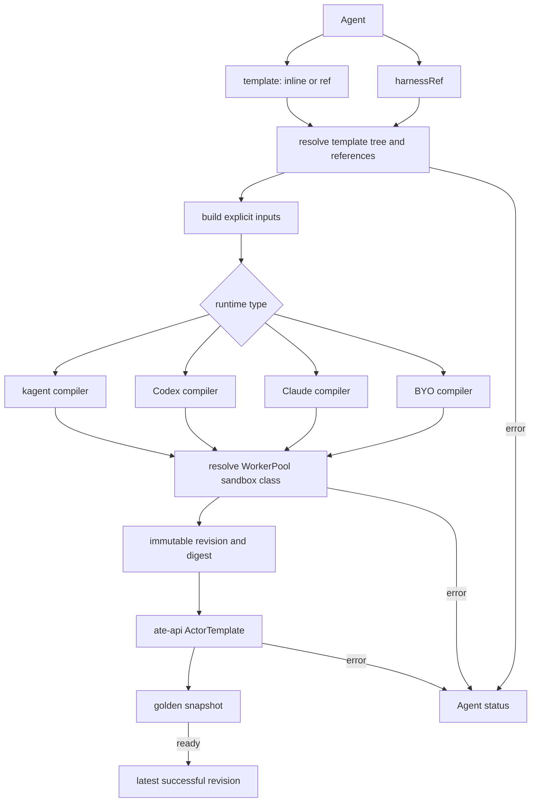

# Configuration and Compilation

## Public configuration

`Harness` describes how to run a class of agents. It selects exactly one runtime
variant—kagent, Codex, Claude, or BYO—and contains workload image/command/args,
literal environment values, WorkerPool configuration, and snapshot location.

`AgentTemplate` describes what the agent does. It contains model configuration,
description and prompt, MCP tool bindings, skills, plugins, and Shared
subagent bindings (`tools[].subAgent`). Model configuration may be omitted for BYO images;
Agent compilation rejects managed harness combinations without one.

`Agent` pairs one template and one Harness. The required `template` field selects
either `inline` for a complete embedded spec or `ref` for a local AgentTemplate.
The required `harnessRef` selects a Harness in the Agent's namespace; Harness
configuration cannot be embedded in an Agent. This boundary lets platform owners
manage runtime policy independently from Agent authors. Inline template specs are
complete values, not overrides. References, including those inside inline specs,
resolve in the Agent's namespace. The reusable resources have no binding to each other. Child templates are selected
with `tools[].subAgent.templateRef` and compile under the parent Agent's Harness.
Each subagent requires `templateRef` and shares the parent's runtime and Harness.
Dedicated `agentRef` bindings are deferred and are not part of the served API.

The resource boundary does not grant authorization by itself. Kubernetes RBAC
controls who may create or update Harnesses; admission policy is required when
Agent authors must also be restricted to an allowlist of Harness references.

All three are `api.kagent.dev/v1alpha3` Kubernetes resources. Infrastructure-derived
values such as runtime addresses and inferred egress do not belong in the public
API.

The `api.kagent.dev` group keeps these definitions separate from legacy
`kagent.dev` resources, including the old `Agent`. `ModelConfig`,
`ModelProviderConfig`, and `RemoteMCPServer` use the new group too. Examples
assume a fresh installation and use `kubectl get agent`. If both agent APIs are
installed, use a qualified resource name such as
`kubectl get agents.api.kagent.dev` to select this API.

### Model streaming

For model endpoints that do not support streaming, set `spec.stream: false` on
the root agent's `ModelConfig`:

```yaml
apiVersion: api.kagent.dev/v1alpha3
kind: ModelConfig
metadata:
  name: non-streaming
  namespace: kagent
spec:
  provider: OpenAI
  model: example-model
  stream: false
  openAI:
    baseUrl: https://models.example.com/v1
```

The kagent harness uses this setting for LLM calls, including OpenAI Chat
Completions and Responses. Omitted or `true` keeps streaming enabled. The root
runner's streaming mode also applies to its shared subagents. Changes prepare a
new revision; create a new Session to use it. A2A task events remain streamable
when model streaming is disabled. This setting does not configure
the Codex or Claude harnesses.

### Harness images and workload overrides

For built-in kagent, Claude, and Codex Harnesses, the whole `workload` block is
optional. Omit it to select the matching release image provided by the installed
chart. BYO requires an explicit image and command; all images must be digest-pinned.

Release image builds run independently. Each runtime build publishes its final
multi-platform index digest as a workflow artifact. `make helm-release` requires
`RUNTIME_IMAGE_METADATA_DIR` and validates the three runtime digests before
assembling `files/builtin-harness-images.json` in a temporary copy of the charts.
It packages the charts there and copies the completed archives into `dist`;
chart sources and any previous artifacts are preserved if packaging fails.
`make helm-publish` depends on this target. The chart supplies
the defaults through `harnessImages` in the mounted controller configuration file.
The controller validates configured images as digest-pinned references and checks
the catalog's nonempty release against its own version.
Neither controller builds nor compilation perform registry lookups.

For development, `make build` records published runtime digests in
`build/runtime-images`. Docker uses Buildx metadata; Podman records the digest
from its push. `make helm-dev` consumes those existing build outputs and writes an
ignored catalog into the source chart before packaging. Missing metadata reports
which images need building; chart preparation and dry runs never build or push images. Both
`make helm-install-provider` and `make kagent-cli-deploy` use this target, so the
charts they install contain the local image defaults. Image references follow
`GOLANG_ADK_IMG`, `CLAUDE_HARNESS_IMG`, and `CODEX_HARNESS_IMG`, including custom
registries and repositories.

Local installations can override individual defaults with
`config.harnessImages`; `global.imageRegistry` rewrites both packaged defaults
and explicit overrides.

The outer compiler sets the selected image on the compiled revision before hashing
it. Adapters receive the requested Harness spec; provenance records that spec
without injected defaults. A missing or invalid
selected image reports `Compatible=False`; unused defaults do not need to be
configured. `Agent.status.workloadImage` reports the image of the desired compiled
revision and clears when compilation fails. Existing Sessions retain their
prepared revisions. Changing a release default prepares a new revision for Agents
using that default; explicit image overrides are independent of catalog changes.
The Harness API's `workloadImage` represents the explicit override and is empty
when the release default is selected. The Harness list displays “Release default”
for this case; Agent status reports the actual selected image.

Default selection does not inspect or validate the CLI version inside an override.

The kagent compiler preserves explicit `spec.workload.command` and
`spec.workload.args` in the runtime revision and generated ActorTemplate,
regardless of the runtime image's implementation language. Omitted overrides
remain unset.

For example, this Harness excerpt selects debug logging for the Go ADK image
without changing the AgentTemplate:

```yaml
spec:
  kagent: {}
  workload:
    command: ["/app"]
    args: ["--log-level", "debug"]
```

Command and argument changes participate in revision identity. They affect newly
prepared revisions, not existing Sessions pinned to an older revision.

## Prepared revision pipeline

The controller compiles each Agent through one pipeline:



1. Resolve the template tree and referenced Kubernetes objects.
2. Build explicit, harness-independent inputs.
3. Select the harness compiler from the runtime-type registration map.
4. Produce an immutable revision containing workload, configuration, Agent Card,
   capacity, snapshot, provenance, and inferred egress inputs.
5. Resolve the Harness's WorkerPool sandbox class, hash the revision, and apply
   it as an ate-api ActorTemplate.
6. Wait for the golden snapshot to become ready.
7. Persist the revision and advance the Agent's latest-successful pointer.

Agent owns readiness, warnings, the desired revision, and the latest successful
revision. AgentTemplate is shared context with no runtime status. Child template
references are resolved under the root Agent's Harness; they do not require
separate Agents or matching Harness references.

A failed compile or apply retains the previous successful revision, which
remains available for fresh Sessions during pending or failed edits. Initial
creation requires a successful revision. Existing Sessions and creation retries
keep their pinned revision. Explicit egress grants use current policies
independently of runtime preparation.

Harness compilers only translate inputs. The controller and Substrate adapter own
application and readiness. The central entry points are
[`translator/compiler.go`](../../go/core/internal/translator/compiler.go) and
[`controller/reconciler.go`](../../go/core/internal/controller/reconciler.go).

Reconciliation and runtime-observation collections compare ActorTemplates and
nested revision Agent Cards with protobuf semantic equality. Lazy protobuf
reflection and size caches are not state changes and must not be inspected by
KRT's reflection-based comparison. Other fields retain their existing equality
semantics.

The compilation graph publishes a target only when the revision, its digest,
and the desired ActorTemplate have all been built successfully. Compilation
diagnostics remain separate from runtime preparation failures. When compilation
fails, `desiredRevision` is empty in status and the persisted desired edge is
cleared; an unresolved request is never represented as a runtime digest. The
last successful revision remains available, while abandoned preparations can
be collected and cannot become the latest successful revision through a delayed
completion.

### WorkerPool sandbox selection

For every harness type, the controller resolves `spec.substrate.workerPoolRef`
in the Agent namespace. Substrate v0.6.0-alpha3 chooses the sandbox runtime from
the selected WorkerPool's `spec.sandboxClasses[]` and `configRef`; ActorTemplates
no longer specify a SandboxConfig. Operators must install the referenced
cluster-scoped SandboxConfig and provision compatible workers and runtime assets.
Selecting `microvm` does not install those prerequisites or configure a Kubernetes
RuntimeClass. The standard configurations are `gvisor-default` and `microvm`.

The central compiler also resolves operator-owned `runtimeDefaults.cpu` and
`runtimeDefaults.memory` into each agent revision. Both limits are required by
Substrate, default to 1 CPU and 1 GiB, and participate in the digest. The Substrate
adapter validates their quantities and emits ActorTemplate resources for every
harness. Standalone sandbox limits remain under `sandboxes` configuration.

A missing WorkerPool reports `WorkerPoolNotFound`; an unsupported class reports
`RevisionInvalid`. Neither produces a desired ActorTemplate. WorkerPool updates
are tracked through KRT and recompute the desired revision.
Empty and explicit `gvisor` hash the explicit `gvisor`
class; both sandbox classes participate in the digest, so a prepared MicroVM runtime
cannot be confused with a gVisor revision. Returning to gVisor restores the
original digest. Existing Sessions remain pinned to their revisions, but the
WorkerPool owns runtime selection. Use a separate pool when existing revisions
must keep using the previous runtime.

Generated ActorTemplates select workers with both `kagent.dev/worker-pool-name`
and `kagent.dev/worker-pool-namespace`. The labels identify the referenced pool's
name and namespace. The Helm chart sets both labels on the pool it creates, and
externally managed pools must carry both. Substrate matches worker labels without
checking them against the pool's namespace. Placement therefore stays within a
namespace only while every pool's labels name the pool's own namespace.

Substrate and persistence failures during preparation report
`Ready=False` with reason `RuntimePreparationFailed`, rather than remaining
silently pending. Status includes a safe error code. Raw backend error messages
are not copied into Kubernetes status. The reconciliation queue owns failure retries,
with exponential backoff from one second to thirty seconds and no operational
attempt budget. It clears the failure after the prerequisite or service recovers.
Periodic polling only checks observed templates whose golden snapshots are still
pending. Observation and status updates do not bypass backoff; changed desired
revisions, unresolved inputs, and Agent deletion are reconciled immediately.
Compilation errors, immutable template conflicts, and golden-snapshot failures
stop preparation until the desired inputs change.

ActorTemplate construction checks the size of each emitted environment value
against Substrate's 32,768-character limit, including the serialized config and
Agent Card. The check counts Unicode code points after JSON encoding, including
its escaping. Oversized values produce `Compatible=False` with reason
`ActorTemplateInvalid` before any Substrate call. A subsequent `InvalidArgument`
from `CreateActorTemplate` is recorded as a terminal `ActorTemplateRejected`
preparation failure. Its backend message is not copied into status because it
can include rejected configuration values. Changing the desired revision allows
preparation to run again.

This selection does not by itself guarantee full MicroVM lifecycle or
cross-node restore compatibility; those also depend on Substrate, runtime
images, and compatible worker hardware.

## Harness-specific output

### OCI skill delivery

OCI sources in `spec.skills` and `spec.plugins` are digest-pinned container
images. Compilation normalizes each reference and emits both a Substrate image
volume and a runtime source directory. The public `source.oci` and optional
`source.path` fields are unchanged. The directory in the internal runtime
contract replaces the former OCI download reference.

Substrate pulls and mounts the whole image read-only before starting the golden
runtime, and prepares the image volume again when restoring an Actor. It uses
the same worker image cache and registry credential path as workload images.
Private registries therefore use the existing Substrate worker credentials;
kagent neither copies those credentials into agent configuration nor adds
registry destinations to agent egress. Kubernetes pod `imagePullSecrets` alone
do not configure worker-side pulls.

Images shared by standalone skills, plugins, or Go ADK shared subagents produce
one volume per normalized reference, mounted at
`/run/kagent/artifacts/<reference-hash>`. Different repositories remain distinct
even when their digests match. Sorted image inputs participate in revision
identity. Substrate currently limits each ActorTemplate to 32 volumes and each
container to 32 mounts; the three runtime volumes leave room for 29 distinct
skill images. Exceeding that limit fails ActorTemplate construction.

The shared materializer resolves `source.path` within the mounted image and
validates that selected package, including its path, symlink, size, and file-type
constraints. Unrelated files outside the selected package are ignored. It copies
selected standalone and Agent Plugins skills to the harness's existing discovery
directory: `/skills` for Go ADK,
`/data/codex/skills` for Codex, and `/data/generated/claude/.claude/skills` for
Claude. Claude loads these selected skills through a generated `kagent-skills`
plugin passed with `--plugin-dir`; `--add-dir` discovery is disabled by the
harness's `--setting-sources` policy. Unselected Agent Plugins skills are not
installed. Claude-format plugin
roots can use the mounted directory directly. Mounted sources do not use the
download cache or fall back to an in-runtime OCI pull.

Package limits and path/symlink validation still apply. Build skill images from
scratch with just package contents; arbitrary ORAS artifact layouts are not
supported. Existing Git and S3 fetches remain runtime operations and retain
their golden-runtime networking limitations. The Python ADK does not yet consume
the `agent_plugins` runtime contract. BYO images must consume that contract to
load these skills; the Go ADK BYO fixture does so.

### Runtime configuration

- **kagent** emits configuration for the Go or Python ADK, the Harness's memory and context
  compaction policy, Shared native subagents, and the kagent HITL extension.
- **Codex** emits native App Server configuration, OpenAI or Bedrock model setup,
  Streamable HTTP MCP servers, Shared agents, and skills. Approvals are currently
  disabled by policy.
- **Claude** emits Anthropic, Bedrock, or Vertex model setup, HTTP/SSE MCP
  servers, Shared agents, and skills.
- **BYO** runs a digest-pinned user image that implements private A2A gRPC and
  `/readyz`, and uses the private TaskStore at `runtime.control_plane_url` for task creation,
  persistence and settlement. The shared Go app and Python runtime builders
  provide this integration. Other images must implement the same TaskStore
  contract; an upstream A2A server with only an in-memory store is insufficient.
  Optional model, prompt, tool, skill, and plugin configuration is
  supplied in the ADK-shaped format when requested.

The kagent and BYO compilers serialize the same `ADKConfig` protobuf
contract from `adk.proto` using ProtoJSON. Go and Python use generated messages;
validation rules live in the schema. Model providers form a required `oneof`,
while a BYO root can omit the model entirely.
`adkconfig.Builder.Build` assembles the agent tree and its model dependencies,
environment, and egress contributions. Harness compilers place that tree under
`agent` and process settings under `runtime` in the top-level `ADKConfig`.
The recursive `ADKAgentConfig` has no runtime field.

The builder compiles the shared agent tree, then applies root runner settings.
Both harnesses receive the durable session URL at `/data/sessions.db`; kagent
also receives its configured memory, compaction, and structured-output policy.
Shared subagents use the root runner's session store and do not receive their
own runtime policy. BYO model configuration remains optional. Supplying the
ADK payload does not make an arbitrary BYO image consume it: the image must
implement the fields it uses and the platform's private runtime contract.

Dedicated agent bindings are not compiled yet.

The Python ADK image's default entrypoint runs a named Python agent module. To
consume the kagent compiler's configuration, set `spec.workload.command` to
`["/.kagent/.venv/bin/kagent-adk", "static", "--host", "0.0.0.0", "--port", "8080"]`.
The compiler sets `runtime.port="80"` for private A2A traffic in both ADKs. Go uses
that port for its shared HTTP/gRPC listener; Python uses it for gRPC and keeps
the HTTP port separate.

`spec.kagent.compaction` on the Harness is runtime policy, like `spec.kagent.memory`:
it belongs to the runner that drives the root agent and is not part of the
portable template. The kagent compiler applies it to every root agent the
Harness runs. A summarizer `ModelConfig` other than the agent's own is resolved
from the Harness namespace like the memory model and joins the revision's
credentials, egress, and provenance.

## Explicit Agent examples

For a single agent, inline the template and reference a Harness:

```yaml
apiVersion: api.kagent.dev/v1alpha3
kind: Agent
metadata:
  name: assistant
  namespace: kagent
spec:
  template:
    inline:
      modelConfig:
        name: default-model-config
      systemPrompt: You are a helpful assistant.
  harnessRef:
    name: kagent
```

The referenced ModelConfig and Harness must already exist.

To reuse an existing AgentTemplate, replace the inline template with its reference:

```yaml
spec:
  template:
    ref:
      name: shared-context
  harnessRef:
    name: kagent
```

Template behavior may be inline or referenced. The Harness is always referenced;
no synthetic Kubernetes object is created for an inline template.

Create a session with `kagent agent session create --agent assistant -n kagent`.
The gRPC create request and ScheduledRun target one `agent` resource reference.
The store selects that Agent's latest successful revision, including while an
edit is pending or failed. Deleting an Agent
retires its definition; sessions and checkpoints retain their pinned revisions.
Recreating the same name creates a new identity and cannot inherit the old
Agent's last successful revision.

This replaces implicit label selection and the old template/Harness inputs as a
breaking API change. SandboxTemplate hosting configuration is not part of this
change.
