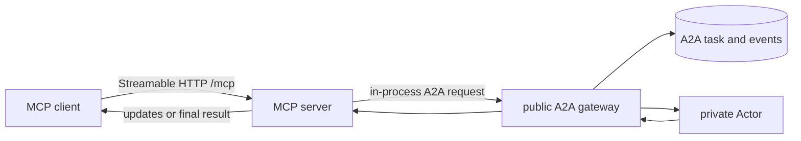

# MCP

Kagent exposes an authenticated, stateless Streamable HTTP MCP endpoint at
`/mcp` on the HTTP port (`8083`). It is another client of the public control-plane
semantics, not a private path to Actors.

Current tools can:

- list accessible Sessions;
- invoke a Session;
- create and list checkpoints;
- fork a Session from a checkpoint;
- discover SandboxTemplates and manage standalone Sandboxes; and
- run sandbox processes, read output, and transfer files.

## Client guidance

The server advertises instructions describing how to combine its tools. Sandbox
tool descriptions include next steps and constraints so tool-only clients also
receive the essential guidance. Clients decide whether to include server
instructions in model context; registering instructions does not force that.

When sandbox execution is available, the server also registers two MCP prompts:

| Prompt | Arguments | Purpose |
| --- | --- | --- |
| `sandbox-task` | Required `task`; optional `namespace` and `template` (template requires namespace) | Select an environment, stage inputs, execute, verify, retrieve artifacts, and clean up |
| `sandbox-recovery` | Required `sandbox_id` UUID | Inspect an interrupted task and identify how to continue without duplicating commands |

Clients discover prompts with `prompts/list` and retrieve messages with
`prompts/get`. Retrieval only renders guidance; it does not access resources or
execute tools. Prompts must be requested by a client and do not automatically
enter an agent's context. The Go ADK's current MCP toolset exposes tools, not
these prompt workflows.

Sandbox guidance covers the independent lifetime, current lack of allowed
egress, `/data/workspace`, base64 transfer limits, asynchronous process status,
output offsets, lifecycle retries, and artifact retrieval before deletion.
See [standalone sandboxes](sandboxes.md) for the runtime contract.

## Session invocation

Invocation calls the in-process public A2A gateway. Streaming MCP clients receive
updates from the same durable A2A task; synchronous clients drain the same stream
to completion.

## MCP Tasks

The server implements the MCP Tasks extension. An opaque base64 task reference
contains the authorized Session and A2A task identity.
`tasks/get`, `tasks/update`, and `tasks/cancel` translate to operations on that
same durable A2A task, including `input-required` continuation. There is no
separate MCP task or session store.

## Extending the server

A program that runs core as a library sets `app.Options.MCPExtensions` to add
tools and resources to this server. The hook receives the `*mcp.Server` after
core registers its own tools. Added tools and resources are served from the same
endpoint, behind the same authenticator, as core's.

The hook can do anything the SDK allows, including middleware. Core's tools are
not protected: registering a name or URI core already uses replaces it.
Authorization inside an added tool stays with the program that adds it.

The implementation is in [`go/core/internal/mcp`](../../go/core/internal/mcp).

## Go ADK runtime discovery

The Go ADK builds lazy MCP toolsets for the root agent and its subagents. Runtime
startup neither connects to HTTP or SSE MCP servers nor starts stdio MCP
processes. Readiness and Actor resume therefore do not wait for remote tool
discovery.

During invocation preparation, ADK opens its MCP connection and discovers tools.
Client sending middleware classifies each raw `tools/list` page before ADK drops
the MCP `_meta` fields. It removes app-only tools and tools outside the configured
allowlist from the response itself. There is no separate classification
connection, second listing, or process-lifetime visibility whitelist.

The MCP SDK caches the **filtered** responses using the server's TTLs. Cache hits
bypass middleware but remain filtered. The SDK owns expiry, catalog-notification
invalidation, and the cache of each connection; kagent neither disables this cache
nor duplicates it. A list-changed handler enables subscriptions for servers using
the newer MCP protocol. Legacy servers without list caching are discovered once
per model step. Discovery and tool calls use the existing credential, approval,
and tracing paths; cached discovery does not replace tool-call authorization.

ADK does not guard against repeated pagination cursors. Kagent carries the visited
cursor path in the opaque cursor ADK sees, restoring the server's original cursor
on outgoing requests. This makes cycle checks include cached prefix pages while
preserving SDK caching and the cursors sent to the server.

Discovery and classification publication are serialized per toolset; waiting
invocations can cancel without interrupting the active listing. This prevents
overlapping listings from mixing app classifications while preserving SDK caching.

MCP App result compaction retains discovered app tool names separately from
visibility filtering. Names absent from the catalog remain available for historical
compaction during the process lifetime. A complete successful listing clears names
that now identify ordinary tools, so their new results reach the model intact.
Because compaction is name-based, their historical app results also stop being
compacted. App names are not exposed before a complete successful discovery, and
failed executions do not consume another execution's recovered metadata. The
before-model callback continues to compact only the model-facing copy; stored
results remain rich for UI rendering. A volume-only restore starts a new process,
so discovery and classification happen again after readiness.

If discovery fails, that server's entire toolset is omitted for the current A2A
execution, including subsequent model steps and subagent calls, even if earlier
discovery succeeded. Healthy toolsets remain available. A later execution retries,
including an approval continuation with reused invocation identifiers. There is
no fallback to unclassified tools. Cancellation and tool-call errors still
propagate. Malformed catalogs and pagination failures follow the same omission
policy and are logged as warnings. ADK retains its existing connection-recovery
retry; kagent adds no background retry loop.

Standalone runners can use `mcp.WithDiscoveryScope(ctx)` for each `runner.Run`
to get the same omission and retry behavior. Without that scope, classification
failure returns an error. Controller-side catalog discovery used by the UI is
independent of runtime discovery.
