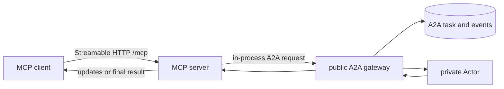

# MCP

Kagent exposes an authenticated, stateless Streamable HTTP MCP endpoint at
`/mcp` on the HTTP port (`8083`). It is another client of the public control-plane
semantics, not a private path to Actors.

Current tools can:

- list accessible Sessions;
- invoke a Session;
- create and list checkpoints;
- fork a Session from a checkpoint;
- discover SandboxTemplates and manage standalone Sandboxes; and
- run sandbox processes, read output, and transfer files.

## Client guidance

The server advertises instructions describing how to combine its tools. Sandbox
tool descriptions include next steps and constraints so tool-only clients also
receive the essential guidance. Clients decide whether to include server
instructions in model context; registering instructions does not force that.

When sandbox execution is available, the server also registers two MCP prompts:

| Prompt | Arguments | Purpose |
| --- | --- | --- |
| `sandbox-task` | Required `task`; optional `namespace` and `template` (template requires namespace) | Select an environment, stage inputs, execute, verify, retrieve artifacts, and clean up |
| `sandbox-recovery` | Required `sandbox_id` UUID | Inspect an interrupted task and identify how to continue without duplicating commands |

Clients discover prompts with `prompts/list` and retrieve messages with
`prompts/get`. Retrieval only renders guidance; it does not access resources or
execute tools. Prompts must be requested by a client and do not automatically
enter an agent's context. The Go ADK's current MCP toolset exposes tools, not
these prompt workflows.

Sandbox guidance covers the independent lifetime, current lack of allowed
egress, `/data/workspace`, base64 transfer limits, asynchronous process status,
output offsets, lifecycle retries, and artifact retrieval before deletion.
See [standalone sandboxes](sandboxes.md) for the runtime contract.

## Session invocation

Invocation calls the in-process public A2A gateway. Streaming MCP clients receive
updates from the same durable A2A task; synchronous clients drain the same stream
to completion.

## MCP Tasks

The server implements the MCP Tasks extension. An opaque base64 task reference
contains the authorized Session and A2A task identity.
`tasks/get`, `tasks/update`, and `tasks/cancel` translate to operations on that
same durable A2A task, including `input-required` continuation. There is no
separate MCP task or session store.

## Extending the server

A program that runs core as a library sets `app.Options.MCPExtensions` to add
tools and resources to this server. The hook receives the `*mcp.Server` after
core registers its own tools. Added tools and resources are served from the same
endpoint, behind the same authenticator, as core's.

The hook can do anything the SDK allows, including middleware. Core's tools are
not protected: registering a name or URI core already uses replaces it.
Authorization inside an added tool stays with the program that adds it.

The implementation is in [`go/core/internal/mcp`](../../go/core/internal/mcp).

## Go ADK runtime discovery

The Go ADK connects to MCP servers and discovers tools during invocation
preparation. Startup and Actor resume do not wait for HTTP or SSE connections
or start stdio MCP processes. This also applies to subagents.

Discovery filters app-only tools and applies configured allowlists before tools
reach the model. The MCP SDK caches filtered responses and owns TTL expiry and
catalog-notification invalidation. Cached tools remain filtered. Credentials,
approvals, and tool-call authorization continue to apply.

If discovery fails, that server's toolset stays hidden for the current A2A
execution, including subsequent model steps and subagent calls. Healthy toolsets
remain available. The next execution retries, including an approval continuation.
There is no fallback to unclassified tools. Discovery failures are logged as
warnings. Cancellation and tool-call errors retain their existing handling.

MCP App results are compacted for the model while stored results remain intact
for UI rendering. Removed app names remain recognized for historical compaction
during the process lifetime. Tools reclassified as ordinary keep their full
output, including historical results. A new process rediscovers app metadata
during invocation preparation.

Standalone runners can use `mcp.WithDiscoveryScope(ctx)` for each `runner.Run`
to get the same omission behavior. Without it, discovery errors propagate.
Controller-side catalog discovery used by the UI is independent.
