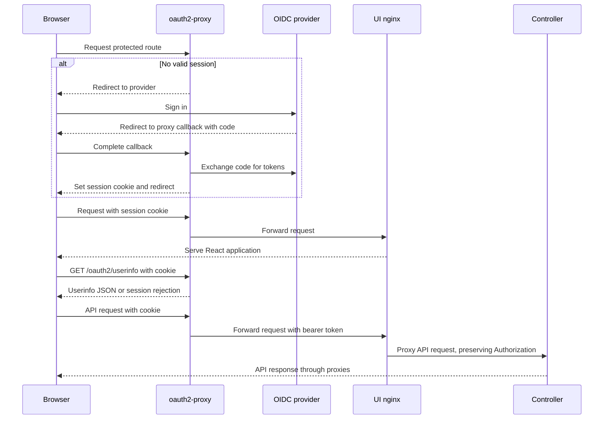

# OIDC proxy authentication

Kagent uses oauth2-proxy to integrate with OIDC identity providers. The proxy owns
sign-in, session cookies, and token refresh. It forwards a bearer token to
upstream services; the React UI reads the browser session through the proxy's
userinfo endpoint.

Browser sign-in and controller authentication are separate boundaries. Set
`controller.auth.mode: trusted-proxy` alongside oauth2-proxy to activate both.
The shipped [controller entrypoint](../../go/core/cmd/controller/main.go) reads
`KAGENT_AUTH_MODE` and `KAGENT_AUTH_USER_ID_CLAIM` and supplies the authenticator
through [app.Options](../../go/core/pkg/app/app.go). Unsupported modes fail
startup. The default remains `insecure`; enabling oauth2-proxy alone does not
change it. Authorization defaults to `NoopAuthorizer`; `controller.authorization.mode:
kubernetes` makes the controller ask Kubernetes RBAC instead (see
[Controller authorization](#controller-authorization)). Library consumers can
supply their own authentication and authorization through `app.Options`.

## Browser session flow

The UI is a Vite-built React application served by nginx. Authentication state
comes from `GET /oauth2/userinfo` with same-origin cookies. The browser does not
decode a JWT from the request that served the page, and there are no server
actions involved.



The [userinfo source](../../ui/src/auth/oauth2ProxyAuthSource.ts) normalizes common
identity fields into a user ID, display name, email, and groups. It does not depend
on a controller `/api/me` endpoint or expose a raw JWT to the UI. The
[API transport](../../ui/src/api/transport.ts) can also attach a bearer token
provided by an application extension.

## Session state and recovery

[AuthProvider](../../ui/src/auth/AuthProvider.tsx) exposes the session result and
whether the initial lookup or an explicit refresh is in progress.

| State | Userinfo response | UI behavior |
| --- | --- | --- |
| `authenticated` | Successful JSON response identifying a user | Display the user and clear the reauthentication guard |
| `expired` | HTTP 401 or 403 | Restart sign-in, subject to the redirect guard |
| `unsecured` | Other unsuccessful responses, non-JSON or invalid data, or a network error | Show no user and do not redirect automatically |

A static deployment without oauth2-proxy can return `index.html` for the userinfo
path. Treating that response as `unsecured` avoids redirecting to a nonexistent
authentication endpoint. This UI state does not establish whether a controller
request is authorized.

On `expired`, [reauthentication](../../ui/src/auth/reauthenticate.ts) redirects to
the configured SSO start path with an `rd` parameter preserving the pathname,
query, and fragment. A `sessionStorage` guard suppresses another automatic
attempt for 60 seconds. Manual sign-in remains available when the guard blocks
an attempt; successful authentication clears it.

The proxy's session cookie and the provider's tokens have separate lifetimes.
The UI reacts to userinfo rejection rather than checking JWT expiry itself.
Token refresh remains the proxy's responsibility. The chart does not configure
`cookie-refresh`, and its default scope omits `offline_access`; operators must
configure refresh according to their identity provider's requirements.

## Controller identity

The [ProxyAuthenticator](../../go/core/internal/httpserver/auth/proxy_authn.go)
implementation decodes bearer JWT payloads without verifying signatures or
expiry. It assumes an upstream boundary already validated the credential.
The shipped controller selects it in `trusted-proxy` mode.

For a direct user request, identity comes from the configured user-ID claim,
defaulting to `sub`. A missing custom claim falls back to `sub`, except in the
`kubernetes` authorization mode, which rejects the request as the API server
rejects such a token; a missing user identity rejects the request. The session retains raw claims and the original
authorization header. `UpstreamAuth` forwards that header and `X-User-Id` to
downstream requests.

In the `kubernetes` authorization mode a direct request whose token's `sub`
names a ServiceAccount (`system:serviceaccount:...`) is not read from its
claims: the controller authenticates it with a TokenReview for the audience
`KAGENT_AUTHORIZATION_SERVICE_ACCOUNT_TOKEN_AUDIENCE` (default `kagent`; the
controller refuses to start with an empty one, which would accept tokens meant
for the API server itself), and the caller is the user name and the groups the
API server returns. A token the API server does not authenticate for that
audience, or authenticates as anything but a ServiceAccount, rejects the
request, as does a TokenReview that fails. This is how an in-cluster client, such as a component
that cleans up after every creator's Sessions, calls the controller with a
projected ServiceAccount token of that audience. A person's token and an agent
request are read as before. The `noop` mode reviews no token.

One such ServiceAccount may be the session reader:
`KAGENT_AUTHORIZATION_SESSION_READER_SERVICE_ACCOUNT` (`<namespace>/<name>`,
empty by default, which admits none) names it, and the controller refuses to
start with it outside `trusted-proxy` authentication and `kubernetes`
authorization, where no TokenReview would stand behind the name. A call
authenticated as that ServiceAccount is admitted to `SessionService/GetSession`
and nothing else: it reads any Session by ID, whoever created it, as the
controller's own calls do, so a platform service that receives a Session ID can
map it to the Session's Agent. Every other gRPC method refuses it with
`PermissionDenied`, and `/mcp` and the A2A HTTP endpoint with `401`, whatever
RBAC binds it; a share token never widens its read beyond the share. The
reader is the API server's word only: a person's token or an agent request
that names the same user is an ordinary caller, and every other ServiceAccount
reads only its own Sessions, as before.

For an agent request with `X-Agent-Name`, a parseable bearer JWT is still required.
The acting user comes from `user_id`, then `X-User-Id`, then the token's `sub`
claim. Headers alone do not authenticate an agent. This path does not perform a
Kubernetes TokenReview or otherwise validate a service-account token.

The [gRPC interceptors](../../go/core/internal/grpcserver/interceptors.go) pass
incoming authentication metadata to the configured provider. Private runtime
methods use their separate runtime authenticator; the proxy's agent-header path
does not define authentication for those methods. See the
[A2A gateway](a2a-gateway.md) for the runtime boundary.

## Controller authorization

Every service consults the configured `auth.CollectionAuthorizer`: `Check` for
one object and `Scope` for a collection read. The shipped controller reads
`KAGENT_AUTHORIZATION_MODE`:

- `noop` (the default) permits every authenticated caller and scopes every
  collection to `ALL`. The controller's own Kubernetes identity reads and
  writes the objects.
- `kubernetes` selects the
  [KubernetesAuthorizer](../../go/core/pkg/auth/kubernetes.go): the API
  server's RBAC on the kagent resources is the one source of truth for what a
  caller sees and runs through the controller, so the API answers the same as
  `kubectl auth can-i` does for the same person. It decides nothing with
  `insecure` authentication, where the caller names its own user ID; the
  controller logs a warning at startup for that pair. A check the API server
  does not answer is reported as `Unavailable`, not as a refusal.

In `kubernetes` mode every check is a `SubjectAccessReview` for the caller,
mapped as the API server's OIDC authenticator maps the same token. The username
is the authenticated user ID, read from the claim `KAGENT_AUTH_USER_ID_CLAIM`
names, with `KAGENT_AUTHORIZATION_USERNAME_PREFIX` before it
(`--oidc-username-prefix`): point that claim at the API server's
`--oidc-username-claim`. Set the prefix to what the API server puts before the
claim, which is not always what its flag says: an empty prefix matches
`--oidc-username-prefix=-`, or an `email` claim with the flag unset; for any
other claim with the flag unset the API server puts `<issuer-url>#` before it,
so set that. With a structured `AuthenticationConfiguration`, use its
`claimMappings.username.prefix`. A prefix that differs reviews a user no
RoleBinding names, and every caller is refused. Choose that claim before the installation holds data:
Sessions, checkpoints, scheduled runs and sandboxes are keyed by the creator's
user ID, so changing the claim later (say from `sub` to `email`) orphans every
person's rows, and the username prefix cannot bridge two claims. The
`trusted-proxy` authenticator reads the groups from
`KAGENT_AUTHORIZATION_GROUPS_CLAIM` (`--oidc-groups-claim`), and the review puts
`KAGENT_AUTHORIZATION_GROUPS_PREFIX` (`--oidc-groups-prefix`) before each;
`system:authenticated` is always among them. A user or a group that maps into
the reserved `system:` space is refused, so no caller is reviewed as a
ServiceAccount, a node or `system:masters`, except a ServiceAccount whose
token the API server authenticated itself (above): it is reviewed under the
user name and groups the TokenReview returned, with no prefix. A caller without a user identity,
such as a runtime actor, is refused. A refused caller receives empty
collections and fails every check.

A person's direct calls and the calls their agent makes for them are one
Kubernetes user with the same groups. When the controller forwards a turn to an
agent's runtime it sends the person's user ID (`X-User-Id`) and groups
(`X-User-Groups`, each group percent-encoded, joined by commas); the Go and
Python runtimes keep both for the turn and send them back on every call to the
controller, which reviews that call with them. On a turn a Session share
admits, the runtime's calls run as the Session's owner: the visitor's groups
are not the owner's, so the calls carry the owner's groups as the owner's last
turn recorded them. The Session keeps them out of the API, and each of the
owner's turns replaces them. Each call is still reviewed against the RBAC of
the time, so a removed RoleBinding takes effect as on any call; a group the
identity provider removes from the owner stays in use on share turns until the
owner's next turn.

The controller does not verify the signature of the token it is given: the
`trusted-proxy` mode trusts the proxy in front of it to have verified it, and
an agent's call names its user in `X-User-Id`. In `kubernetes` mode whoever
reaches the controller's API port therefore picks whose RBAC applies. Keep that
port to the verifying proxy and the agent runtimes: `controller.networkPolicy`
renders a NetworkPolicy that admits the chart's UI and the peers
`controller.networkPolicy.from` names, and leaves the metrics port open (the
kubelet's probes come from the node, which common CNIs admit). An agent's
runtime can still name any person; a verifiable delegation of the person to the
runtime is not part of this mode.

| Operation | Reviewed as |
| --- | --- |
| A Kubernetes object (`Agent`, `AgentTemplate`, `Harness`, `ModelConfig`, `SandboxTemplate`, a tool server as `remotemcpservers`, a prompt template as `configmaps`) | the verb on that object, in its namespace; a list is `list` in the request's namespace |
| `ListToolServers`, `ListTools` | scoped like a collection read of `remotemcpservers`: the tool servers, and their tools, in the namespaces where the caller may `list` them |
| `CreateSession`, and an A2A `message/send` that starts a conversation | `get` on the Agent and `create` on the virtual resource `sessions.api.kagent.dev` in the Agent's namespace |
| Every further turn: an A2A `message/send` that names a conversation or a running task | `get` on the Agent, for the person who sends it (the owner and a share's visitor alike), so a revoked grant stops the next turn |
| A scheduled run | the same two reviews for its Agent, when the schedule is created; its executions run as the controller, so a grant revoked later does not stop a schedule — delete the schedule |
| A fork of a checkpoint | `get` on the checkpoint's Agent and `create` on `sessions.api.kagent.dev` in its namespace, as a new Session |
| Reading, sharing or deleting a Session; checkpoints, scheduled runs, sandboxes | not reviewed: their service already limits them to the caller's own rows or to a share |
| The tool server types; the Substrate inventory (`GetSubstrateSummary`, `ListSubstrateActors`, `ListSubstrateWorkers`) | not reviewed: they name no Kubernetes object |
| `ListSessions` with `all_creators` | `list` on `sessions.api.kagent.dev` cluster-wide (no namespace), since the list spans every namespace: a ServiceAccount granted it by a ClusterRole lists every creator's Sessions, and a person, who normally has no such grant, is refused; a ClusterRole with wildcard resources or verbs, such as `cluster-admin`, grants it too |
| The controller's own calls (no principal) | permitted |

A collection read (`ListAgentTemplates`, `ListAgents`, ...) is scoped to the
namespaces in which the caller may `list` the resource: one review per
namespace, after a cluster-wide review that short-circuits to the whole
collection. A caller allowed nowhere receives an empty collection, never
`PermissionDenied`. The namespaces are the controller's `KAGENT_WATCH_NAMESPACES`
when it watches a fixed list, otherwise every Namespace, narrowed by the label
selector `KAGENT_AUTHORIZATION_NAMESPACE_SELECTOR` when one is set, plus the
namespaces `KAGENT_AUTHORIZATION_INCLUDE_NAMESPACES` names whatever their labels
(a shared namespace one selector cannot express beside the others). Decisions
are cached for ten seconds per subject, verb and resource, so a changed
RoleBinding takes effect within that time; concurrent checks of one decision
send one review. A review is bounded to five seconds, and a caller waits for it
no longer than its own deadline: an API server that stops answering shows as
`Unavailable` within seconds.

The chart renders the settings from `controller.authorization` and, in
`kubernetes` mode, a ClusterRole and ClusterRoleBinding that let the
controller's ServiceAccount create `subjectaccessreviews` and `tokenreviews`;
`controller.authorization.serviceAccountTokenAudience` sets the audience. Kubernetes RBAC then
grants the callers: a person who may `list` and `get` `agenttemplates` and
`agents` and `create` `sessions` in a namespace sees and runs the agents there.

## CLI

The CLI reaches the controller as a direct user: every control-plane gRPC call
and every A2A call carries `authorization: Bearer <caller token>` beside
`x-user-id`, so a `trusted-proxy` controller identifies the caller from the
token's claims and an `insecure` one keeps selecting the partition by user ID.
The token comes from the first of `--caller-token`, `KAGENT_TOKEN` and the
credential of the current kubeconfig context — a static token, an exec plugin's
credential or an oidc `id-token`, read through client-go the way kubectl sends
it. A context whose credential is a client certificate offers no bearer.

`kagent session invoke --token` passes a model API key through as the A2A
bearer and keeps that slot when both are set: the server reads one
authorization value. A `trusted-proxy` controller therefore takes no model key
on A2A calls; the CLI's refusal message says so.

An `Unauthenticated` answer names what to do: with no token resolved, the
three ways to supply one; with a token sent, its source; with a model key in
the slot, the conflict.

## Deployment configuration

oauth2-proxy is an optional dependency in
[Chart-template.yaml](../../helm/kagent/Chart-template.yaml). Its
[Helm values](../../helm/kagent/values.yaml) configure the provider, client and
cookie secrets, issuer and callback URLs, and upstream UI service. The default
upstream is `http://kagent-ui:8080`; override it when the release's service name
differs.

| Setting | Default | Purpose |
| --- | --- | --- |
| `oauth2-proxy.enabled` | `false` | Install the authentication proxy |
| `oauth2-proxy.config.existingSecret` | Empty | Reference client and cookie credentials |
| `controller.auth.mode` | `insecure` | Select `insecure` or `trusted-proxy` |
| `controller.auth.userIdClaim` | Empty (`sub`) | JWT identity claim, falling back to `sub` (not in `kubernetes` authorization mode) |
| `controller.authorization.mode` | `noop` | Select `noop` or `kubernetes` |
| `controller.authorization.usernamePrefix` | Empty | Prefix before the user ID `kubernetes` mode reviews |
| `controller.authorization.groupsClaim`, `.groupsPrefix` | Empty | How `kubernetes` mode builds the reviewed groups |
| `controller.authorization.namespaceSelector` | Empty | Namespaces a collection read ranges over |
| `controller.authorization.includeNamespaces` | Empty | Namespaces ranged over beside the selected ones |
| `controller.authorization.serviceAccountTokenAudience` | `kagent` | Audience a ServiceAccount token must carry in `kubernetes` mode |
| `controller.authorization.sessionReaderServiceAccount` | Empty | ServiceAccount (`<namespace>/<name>`) admitted to `SessionService/GetSession` for every Session, and to nothing else, in `kubernetes` mode |
| `controller.networkPolicy.enabled`, `.from` | `false`, empty | Admit only the UI and these peers to the controller's API port |
| `ui.auth.ssoRedirectPath` | `/oauth2/start` | Start or restart browser sign-in |

For a release named `kagent`, register
`https://agents.example.com/oauth2/callback` with your OIDC provider. Create a
Secret named `kagent-oidc` in the release namespace with `client-id`,
`client-secret`, and `cookie-secret` (a random 32-byte key, base64 encoded).
Install with these values and your normal model/runtime configuration:

```yaml
controller:
  auth:
    mode: trusted-proxy
    userIdClaim: email
  service:
    type: ClusterIP
ui:
  service:
    type: ClusterIP
oauth2-proxy:
  enabled: true
  config:
    existingSecret: kagent-oidc
  extraArgs:
    oidc-issuer-url: https://id.example.com/realms/agents
    redirect-url: https://agents.example.com/oauth2/callback
    upstream: http://kagent-ui:8080
    reverse-proxy: true
```

Route the public HTTPS hostname to `kagent-oauth2-proxy:4180`, including
`/oauth2/`, `/api/`, `/a2a/`, and `/mcp`. The proxy forwards to UI nginx,
which routes API, A2A, and MCP requests to the controller. Do not enable a
second ingress, HTTPRoute, or OpenShift Route directly to the UI or controller.
The chart's default `skip-jwt-bearer-tokens: true` allows API clients presenting
a valid JWT for the configured OIDC issuer/client to use this same public path.
The proxy verifies those tokens, including signature and expiry.

The UI reads `SSO_REDIRECT_PATH` from `window.environmentVariables` at runtime
and applies its configured base path. Helm supplies that value from
`ui.auth.ssoRedirectPath` through `KAGENT_UI_SSO_REDIRECT_PATH`. The chart allows
unauthenticated access to the login page, health checks, and the assets required
to render the login page.

## Trust boundary

The proxy validates external credentials and manages the HttpOnly session
cookie. A backend using `ProxyAuthenticator` trusts that validation; decoding
claims does not verify a token. Such a deployment must prevent callers from
bypassing the proxy or supplying trusted internal identity headers directly.

The [UI nginx configuration](../../helm/kagent/files/nginx.conf) preserves
`Authorization` while proxying API requests. It clears its listed
`X-Auth-Request-*` and `X-Forwarded-*` identity headers unless explicitly allowed
by `ui.additionalForwardedHeaders`. In `trusted-proxy` mode it always clears
`X-Agent-Name` and `X-User-Id` on API, A2A, and MCP requests, even if listed,
so external callers cannot select the internal agent authentication path.

The chart does not install a dedicated NetworkPolicy enforcing this boundary.
Operators must restrict UI ingress to the proxy and controller ingress to UI
nginx and explicitly trusted internal workloads, using NetworkPolicy enforced
by the cluster's network plugin or equivalent isolation. ClusterIP alone does
not prevent bypass from another pod. Keep native gRPC, runtime methods, and
the controller's direct HTTP/MCP listener private. Trusted internal callers
must validate credentials before supplying user/agent identity headers.
Neither a forged signature nor an expired token is rejected by
`ProxyAuthenticator` itself.
