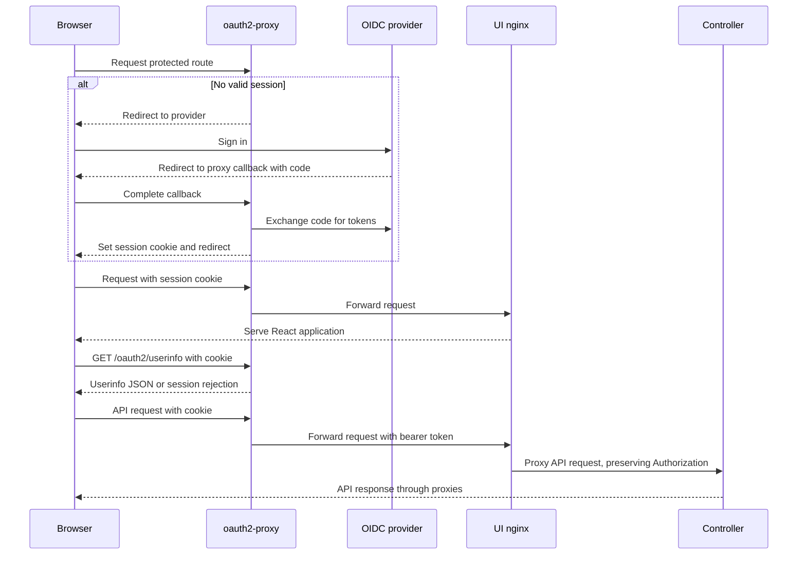

# OIDC proxy authentication

Kagent uses oauth2-proxy to integrate with OIDC identity providers. The proxy owns
sign-in, session cookies, and token refresh. It forwards a bearer token to
upstream services; the React UI reads the browser session through the proxy's
userinfo endpoint.

Browser sign-in and controller authentication are separate boundaries. Set
`config.server.auth.mode: trusted-proxy` alongside oauth2-proxy to activate both.
The shipped [controller entrypoint](../../go/core/cmd/controller/main.go) reads
`server.auth.mode` and `server.auth.userIdClaim` from the config file and supplies the authenticator
through [app.Options](../../go/core/pkg/app/app.go). Unsupported modes fail
startup. The default remains `insecure`; enabling oauth2-proxy alone does not
change it. Authorization still defaults to `NoopAuthorizer`; library consumers
can supply their own authentication and authorization through `app.Options`.

## Browser session flow

The UI is a Vite-built React application served by nginx. Authentication state
comes from `GET /oauth2/userinfo` with same-origin cookies. The browser does not
decode a JWT from the request that served the page, and there are no server
actions involved.



The [userinfo source](../../ui/src/auth/oauth2ProxyAuthSource.ts) normalizes common
identity fields into a user ID, display name, email, and groups. It does not depend
on a controller `/api/me` endpoint or expose a raw JWT to the UI. The
[API transport](../../ui/src/api/transport.ts) can also attach a bearer token
provided by an application extension.

## Session state and recovery

[AuthProvider](../../ui/src/auth/AuthProvider.tsx) exposes the session result and
whether the initial lookup or an explicit refresh is in progress.

| State | Userinfo response | UI behavior |
| --- | --- | --- |
| `authenticated` | Successful JSON response identifying a user | Display the user and clear the reauthentication guard |
| `expired` | HTTP 401 or 403 | Restart sign-in, subject to the redirect guard |
| `unsecured` | Other unsuccessful responses, non-JSON or invalid data, or a network error | Show no user and do not redirect automatically |

A static deployment without oauth2-proxy can return `index.html` for the userinfo
path. Treating that response as `unsecured` avoids redirecting to a nonexistent
authentication endpoint. This UI state does not establish whether a controller
request is authorized.

On `expired`, [reauthentication](../../ui/src/auth/reauthenticate.ts) redirects to
the configured SSO start path with an `rd` parameter preserving the pathname,
query, and fragment. A `sessionStorage` guard suppresses another automatic
attempt for 60 seconds. Manual sign-in remains available when the guard blocks
an attempt; successful authentication clears it.

The proxy's session cookie and the provider's tokens have separate lifetimes.
The UI reacts to userinfo rejection rather than checking JWT expiry itself.
Token refresh remains the proxy's responsibility. The chart does not configure
`cookie-refresh`, and its default scope omits `offline_access`; operators must
configure refresh according to their identity provider's requirements.

## Controller identity

The [ProxyAuthenticator](../../go/core/internal/httpserver/auth/proxy_authn.go)
implementation parses bearer JWT claims without verifying signatures. It rejects
malformed or expired `exp` claims when present, including before forwarding the
credential. It assumes an upstream boundary already validated the signature,
issuer, audience, and other required claims.
The shipped controller selects it in `trusted-proxy` mode.

For a direct user request, identity comes from the configured user-ID claim,
defaulting to `sub`. A missing custom claim falls back to `sub`; a missing user
identity rejects the request. The principal ID combines the issuer and selected
subject into an opaque identifier. Consumers must not parse it or treat it as a
display name. The session retains the claims and original bearer credential.
`UpstreamAuth` forwards that credential and the opaque principal ID in
`X-User-Id`; this header does not grant authority to callbacks.

`X-Agent-Name`, `X-User-Id`, and the `user_id` query parameter do not select an
acting user in trusted-proxy mode. Actor identity comes from a verified Substrate
credential and its current Session binding.

Kubernetes service-account authentication can be enabled independently of the
user authentication mode with `config.server.auth.serviceAccount.authority`.
It uses the local cluster's TokenReview API with the `kagent-invocation` audience.
The principal ID combines the configured authority and the verified service-account
UID, so token rotation preserves identity and recreation changes it. Use distinct
authorities when identities from multiple clusters share storage.

Tokens with a `kubernetes.io` claim or a `system:serviceaccount:` subject always
take this verifier when enabled. Verification failure never falls back to the
trusted proxy, including for federated credentials from another cluster. Unverified
claims only select the verifier; TokenReview establishes identity and authority.

Direct machine callers intentionally forward their verified inbound token, like
human callers. That token retains its Kagent authority wherever it is forwarded;
passthrough destinations must be trusted with it. An embedding application's
`UpstreamAuth` hook may replace or suppress the credential. Forwarding within a
request reuses its verified credential and checks expiry locally.

Each controller caches up to 1,024 successful TokenReviews by token hash and
requested audience for 30 seconds, capped by the token's expiry when present.
Cache hits do not extend that lifetime. Concurrent lookups for the same credential
share one review; failed reviews are not cached, and an unavailable Kubernetes API
never extends an expired entry. Revocation can therefore take up to 30 additional
seconds to become visible. Token rotation uses a new cache key immediately.

`GetCurrentUser.claims` returns provider-specific attributes, not a normalized
profile: proxy claims for OIDC, `username` and `groups` for service accounts, or
an opaque `sub` for sessions without claims. It is not the UI's userinfo source.

The [gRPC interceptors](../../go/core/internal/grpcserver/interceptors.go) pass
incoming authentication metadata to the configured provider. Actor calls use the
same listener and shared authentication provider. Actor JWTs are verified and bound
to their current session, then services enforce the actor resource policy. This
also applies to HTTP MCP and A2A. Invalid actor credentials cannot fall back to
user authentication. See the
[A2A gateway](a2a-gateway.md) for the runtime boundary.

## Deployment configuration

oauth2-proxy is an optional dependency in
[Chart-template.yaml](../../helm/kagent/Chart-template.yaml). Its
[Helm values](../../helm/kagent/values.yaml) configure the provider, client and
cookie secrets, issuer and callback URLs, and upstream UI service. The default
upstream is `http://kagent-ui:8080`; override it when the release's service name
differs.

| Setting | Default | Purpose |
| --- | --- | --- |
| `oauth2-proxy.enabled` | `false` | Install the authentication proxy |
| `oauth2-proxy.config.existingSecret` | Empty | Reference client and cookie credentials |
| `config.server.auth.mode` | `insecure` | Select `insecure` or `trusted-proxy` |
| `config.server.auth.userIdClaim` | Empty (`sub`) | JWT identity claim, falling back to `sub` |
| `config.server.auth.serviceAccount` | Unset | Opt in to local TokenReview authentication with a configured authority |
| `ui.auth.ssoRedirectPath` | `/oauth2/start` | Start or restart browser sign-in |

For a release named `kagent`, register
`https://agents.example.com/oauth2/callback` with your OIDC provider. Create a
Secret named `kagent-oidc` in the release namespace with `client-id`,
`client-secret`, and `cookie-secret` (a random 32-byte key, base64 encoded).
Install with these values and your normal model/runtime configuration:

```yaml
config:
  server:
    auth:
      mode: trusted-proxy
      userIdClaim: email
controller:
  service:
    type: ClusterIP
ui:
  service:
    type: ClusterIP
oauth2-proxy:
  enabled: true
  config:
    existingSecret: kagent-oidc
  extraArgs:
    oidc-issuer-url: https://id.example.com/realms/agents
    redirect-url: https://agents.example.com/oauth2/callback
    upstream: http://kagent-ui:8080
    reverse-proxy: true
```

Route the public HTTPS hostname to `kagent-oauth2-proxy:4180`, including
`/oauth2/`, `/api/`, `/a2a/`, and `/mcp`. The proxy forwards to UI nginx,
which routes API, A2A, and MCP requests to the controller. Do not enable a
second ingress, HTTPRoute, or OpenShift Route directly to the UI or controller.
The chart's default `skip-jwt-bearer-tokens: true` allows API clients presenting
a valid JWT for the configured OIDC issuer/client to use this same public path.
The proxy verifies those tokens, including signature and expiry.

The UI reads `SSO_REDIRECT_PATH` from `window.environmentVariables` at runtime
and applies its configured base path. Helm supplies that value from
`ui.auth.ssoRedirectPath` through `KAGENT_UI_SSO_REDIRECT_PATH`. The chart allows
unauthenticated access to the login page, health checks, and the assets required
to render the login page.

## Trust boundary

The proxy validates external credentials and manages the HttpOnly session
cookie. A backend using `ProxyAuthenticator` trusts that validation; decoding
claims does not verify a token. Such a deployment must prevent callers from
bypassing the proxy or supplying trusted internal identity headers directly.

The [UI nginx configuration](../../helm/kagent/files/nginx.conf) preserves
`Authorization` while proxying API requests. It clears its listed
`X-Auth-Request-*` and `X-Forwarded-*` identity headers unless explicitly allowed
by `ui.additionalForwardedHeaders`. In `trusted-proxy` mode it always clears
`X-Agent-Name` and `X-User-Id` on API, A2A, and MCP requests, even if listed,
as defense in depth; the authenticator does not accept them as Actor identity.

The chart does not install a dedicated NetworkPolicy enforcing this boundary.
Operators must restrict UI ingress to the proxy and controller ingress to UI
nginx and explicitly trusted internal workloads, using NetworkPolicy enforced
by the cluster's network plugin or equivalent isolation. ClusterIP alone does
not prevent bypass from another pod. Keep native gRPC, runtime methods, and
the controller's direct HTTP/MCP listener private. Trusted internal callers
must validate user credentials before forwarding them. `ProxyAuthenticator`
rejects an expired `exp` claim, but it does not verify signatures or require an
expiry claim. These checks do not replace upstream credential verification.
