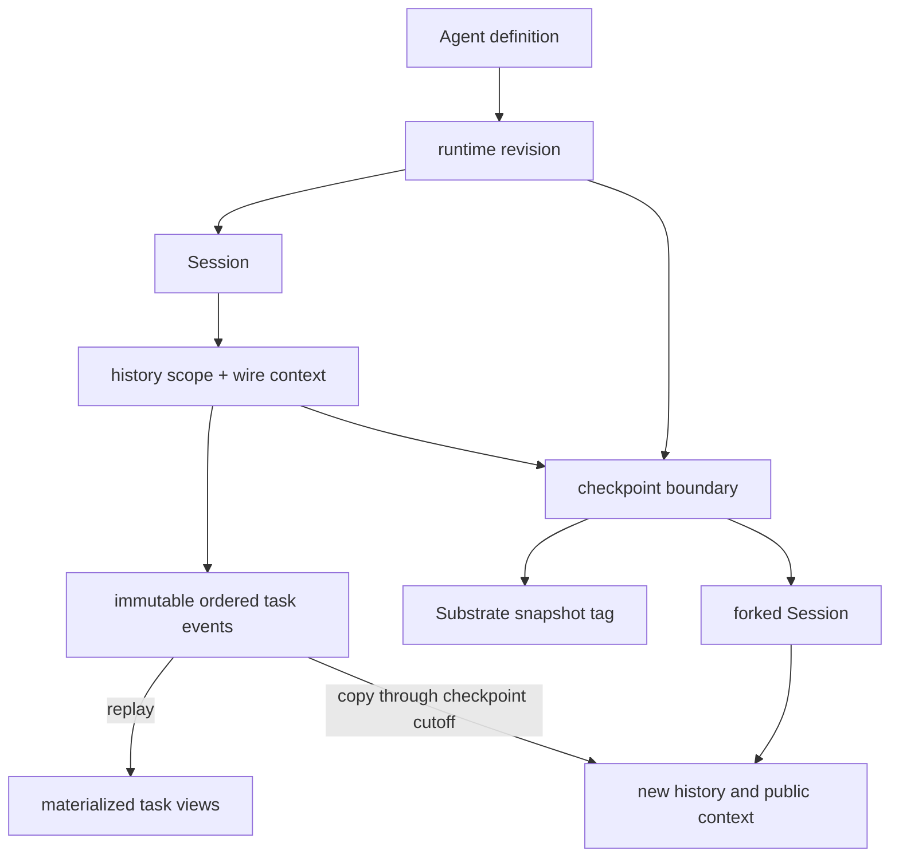

# Persistence, Checkpoints, and Forks

## Durable interaction model

`Session` is a stable conversation identity. Its replaceable Substrate Actor
provides compute; PostgreSQL owns public task history. `Session.id` equals
its public A2A context ID. The private `history_id` selects durable history and a
composite foreign key ensures the context binding agrees with `a2a_context`.
Forks receive new session, context, and history IDs.

The core PostgreSQL records are:

| Record | Purpose |
| --- | --- |
| `runtime_revision` | Immutable compiled input and ate-api identity |
| `agent_definition` | Agent status and latest successful revision |
| `session` | Conversation identity, pinned revision, lifecycle phase, and Actor identity |
| `session_share` | Session authorization grants |
| `a2a_context` | Durable history scope and its wire A2A context binding |
| `session_task` | Rebuildable current A2A task state and query indexes |
| `session_task_event` | Authoritative append-only task and message events, with creation and runtime-boundary metadata |
| `session_checkpoint` | Named immutable snapshot/history boundary |

Identity columns use PostgreSQL's native UUID type. Other framework-specific
tables are runtime implementation details, not part of this ownership model.

Session, checkpoint, and share request IDs are validated as UUIDs by the gRPC
Protovalidate interceptor before handlers run. Services also validate IDs from
MCP and direct callers. The store passes SQL parameters safely and returns errors
for malformed IDs rather than panicking.

Parameterized SQL lives beside its owning store operation. When production code
and tests need the same query, they share a private helper accepting the existing
pool/transaction executor. Tests can inspect stored payloads through those helpers
without duplicating SQL. Transaction boundaries remain with the owning operation.

## Checkpoint creation

A checkpoint names a durable terminal boundary with a matching native snapshot.
TaskStore publishes task completion after native cleanup; the independent
Session lifecycle worker records its snapshot later. Creating a checkpoint
returns FailedPrecondition until that snapshot is ready.
Input-required and auth-required tasks are durably suspended with VOLUMES snapshots
but are not checkpointable or forkable; callers must resolve the interaction first.
Creating a checkpoint does not suspend the Actor again:

1. Reserve the checkpoint in PostgreSQL.
2. Verify that the suspended Actor still holds the external snapshot URI and fidelity recorded on the boundary.
3. Create a Substrate `Tag`, which copies the Actor's current snapshot into independent storage, and verify the source did not change during the copy.
4. Atomically persist the Tag UID and copied snapshot URI and mark the checkpoint ready.

The request inserts the `CREATING` reservation and its bounded execution claim
in one transaction, copies the tag inline, then conditionally publishes `READY`
or `FAILED` while clearing the claim in the same update. Database transactions
never span Substrate calls. The normal create path writes only the reservation
and final outcome; it does not acquire a second claim or poll for a worker.

Each attempt shares a request deadline of at most two minutes with its claim.
Retries with the same owner/request ID reuse the existing reservation. They
acquire expired work and execute the same function, or return the current outcome
when another request owns it. A live operation returns retryable `Aborted`.
Backend errors describe the current attempt, without persisting an error that a
later repaired request could accidentally replay. Public errors exclude backend
configuration. A canceled or uncertain attempt retains `CREATING` and expires its
claim immediately while retaining the executor identity.

A small leader-elected sweep runs at startup and waits thirty seconds after each
completed sweep before starting another. It reads only expired `CREATING` and
`DELETING` work and uses the same execution path as requests. Claims fence publication and deletion across replicas, restarts, and
paused executors; a delayed release cannot revoke a replacement claim. Slow
operations can delay later background work; each attempt remains bounded by two
minutes. The post-sweep interval paces background retries. Live requests execute
independently of the sweep, without a queue, retry map, or wakeup protocol.

A pending tag is not evidence of abandonment. Substrate holds its Actor and Tag
leases through `CreateTag`, including copying and finalization. Recovery calls
`CreateTag` before interpreting `AlreadyExists`: that reply establishes that the
previous serialized attempt stopped, but does not establish copy completion.
A busy backend lease returns `Aborted`; that leaves creation pending without
inspecting or cleaning the still-live tag. A later retry can adopt the completed
copy under the same request ID.

Kagent must still verify the tag's identity, template lineage, completed storage,
and the source Actor's snapshot and UID. Transport errors retain admission until
a subsequent serialized attempt establishes an outcome.

After a copy has stopped, failed verification marks the checkpoint `FAILED` and
releases source admission. Its exact tag UID remains retained for explicit
UID-conditional deletion, including when tag storage is still `PENDING` and has
no completed URI. Failed checkpoints cannot be forked. Their history and revision
references remain pinned until deletion succeeds. An unrelated or replaced tag
is never adopted or deleted.

The first upgrade from a controller without checkpoint execution claims requires
an explicit boundary: quiesce checkpoint creation/deletion, stop every old
controller, and wait for those processes to exit before starting the new version
and resuming checkpoint requests. Merely marking a Pod unready is insufficient.
Legacy reservations have NULL claims; recovery waits until their UUIDv7 creation
age exceeds the two-minute operation timeout. This grace is an additional delay,
not proof that an old writer exited: old code has no bounded overall operation
and can wait in a reservation transaction. Do not mix old checkpoint writers with
new recovery. Future rollouts between claim-aware controllers can remain rolling.
Before downgrading to a controller without execution claims, finish pending
checkpoint operations, delete failed
checkpoints that retain tag UIDs, and drain all current writers. Legacy deletion
requires a completed URI and cannot collect a retained partial failed tag.
The upgrade suite keeps its old-code/new-schema checks, drains every legacy Pod
before starting the new controller, and repeats that boundary before application
rollback. A separate process-lifetime test holds a terminating legacy Pod to
verify that scaling to zero or losing readiness alone does not open the boundary.

Kagent requests synchronous Substrate suspension before recording a checkpoint.
If an earlier attempt already suspended the Actor but left a pending durable
upload, the adapter waits within the request deadline for that same snapshot
generation. Actor replacement, state changes, and generation changes fail the
attempt; the existing durable workflow retains retry authority.

Substrate v1.0.0 records snapshot lineage in
`Actor.status.snapshots[].actor_template_uid`. Kagent selects the newest generation
and requires a COMPLETED durable copy. The Tag's template UID must
match that lineage, and the Actor UID must remain unchanged across the copy.

The `CREATING` reservation blocks task writes and idle or explicit lifecycle changes until the
copy is definitively verified or failed. A lost response can reuse a completed Tag;
a stopped incomplete copy becomes FAILED and retains its Tag UID for deletion. A
failed database finalization leaves the reservation and completed Tag for retry.
Idle lifecycle work records snapshots without retaining every turn: only explicit
checkpoints survive subsequent suspends or source deletion.

The checkpoint retains source-session provenance, source history, prepared
revision, name, head task, and history sequence. Reservation saves an event
cutoff in the same transaction as the runtime boundary reference. Later replies
append events beyond that cutoff and cannot change the saved task state.
The head identifies the task whose snapshot
covers the latest history event, including when an older paused task resumes. The source Session may be
deleted while its context and checkpoint remain.

Deletion first hides the checkpoint, then deletes its snapshot tag, then removes
the row. A checkpoint referenced by a fork cannot be deleted. Substrate deletes the Tag's copied snapshot with the Tag.

Failed checkpoints can also be deleted by their owner. Creation marks a checkpoint
failed after the serialized copy has stopped and verification has failed.
Deletion verifies that absence before removing the row; it never deletes an
unexpected tag without a retained UID. Backend errors leave the checkpoint in
`DELETING` for the checkpoint worker to retry. Its history and runtime revision
references remain retained until deletion completes. Checkpoints still in
`CREATING` cannot be deleted through this path.

Checkpoint deletion passes the retained tag UID as a Substrate delete precondition,
so a tag replaced after lookup cannot have its snapshot deleted. A rejected delete
keeps the checkpoint record and its references for retry.

## Forking

Templates use VOLUMES snapshots for suspension. `ForkSession`
accepts only VOLUMES checkpoints, which cold-boot with fresh session identities;
MEMORY and ROOTFS checkpoints return `FAILED_PRECONDITION`.
The rest of this section describes forks of VOLUMES checkpoints.

Forking creates a new Session and context ID. It copies events through the
saved cutoff and reconstructs task views without reading the source's current task
views. During that copy, the store assigns fresh task IDs and rewrites typed A2A
context/task references, including message `referenceTaskIds`. Message and artifact
IDs, opaque metadata, and protobuf unknown fields remain intact. Task IDs are
globally unique, so a task-only request at the Agent endpoint is unambiguous. There
is no permanent public/native task translation table.

A separate Actor starts from the checkpoint's snapshot Tag. Go and Python ADK
Actor-local session stores use private conversation keys independent of public IDs
and share callers; Codex and Claude retain their native session IDs. New requests
carry the fork's public context ID while native history remains available. All tasks
must be terminal before a checkpoint can be captured, so pending native tool calls
cannot retain obsolete public task identities. Remote-agent IDs in opaque metadata
still name those remote conversations and are not rewritten.

New work appends only to the fork's history. Source history and the checkpoint remain
immutable. The copied head boundary uses the retained Tag URI, allowing a fresh fork
to be checkpointed before its first turn. Fork creation verifies the Tag UID and URI
as well as the Actor's source Tag, suspended state, template, and external snapshot.

Checkpoint sharing is not implemented. Future sharing must be restricted to data
snapshots without process state.

The workflow lives in
[`go/core/internal/service/checkpoint`](../../go/core/internal/service/checkpoint).

Tasks have an immutable `position` independent of their opaque IDs and mutable
status timestamps. Forks preserve this position. Lists across conversations order by `(position, task ID)`
to distinguish source/fork copies at the same position.
New tasks append after inherited tasks, including through repeated forks.

Task creation records a full A2A Task event and its position. Later events carry
task snapshots or incremental status/artifact changes;
message-only replies also record their explicit status transition. Live persistence
and replay use the same protobuf reducer, preserving opaque fields in unchanged
subtrees. Event writes and task-view updates commit atomically. Runtime boundaries
are retained on their final task events so the task's snapshot index is rebuildable.

Forks rewrite public identities while copying event payloads. Private mutation
receipts, settlement acknowledgements, and idle lifecycle claims are not inherited.
Fork task versions belong to the fork's new event sequence. The new actor's projected identity and JWT
select its own history authority on every request.
 Their final boundary references the retained
snapshot Tag, and event sequence references are rebound to the fork's event rows.
Checkpoint creation does not copy task views. Fork reconstruction costs a traversal
of the saved event history; malformed or incomplete history fails the fork transaction.

Authority-scoped snapshot cloning is a kagent contract; A2A does not specify
snapshot forks. The Agent endpoint and globally unique task ID identify a task.
Reads, writes, cancellation, subscriptions, authorization, and dispatch remain
scoped to the resolved session. Forks have independent public identities.

## Schema migrations

Merged migration files are immutable. Core changes use new transactional Goose
migrations, including the two nullable checkpoint claim columns.
Development databases created from older, rewritten alpha baselines still need
to be recreated; new migrations do not bridge those historical schemas.

Deploy the controller and clients together: clients must use `Session.context_id`
or omit the context and let the routed gateway resolve it.

## Malformed scheduling records

Cron reservation removes schedules with undecodable payloads or invalid scheduling
configuration from the due queue by clearing `next_execution_time`. Their bytes
remain intact, and an error log identifies each affected schedule. Repair requires
correcting the persisted payload and restoring its next execution time. Clearing
the queue entry prevents even a full batch of malformed rows from starving healthy
schedules; database write failures still roll back the transaction.

Execution leasing reports and skips individual malformed payloads, returning the
healthy leases from the same batch. The malformed records retain their existing
30-second lease delay and become eligible again after repair. Their runtime state
is not changed: a decoding error does not establish whether an actor has stopped.

Get and List continue to reject malformed payloads. An owner can still delete a
malformed schedule by ID: ownership and tombstoning use database columns, and the
response contains only ID, creator, creation/update timestamps, and deletion time.
It does not synthesize configuration or an etag from damaged bytes. Deletion retries
return the same tombstone, the original payload remains stored, and execution
history is retained. Valid schedules keep their existing full deletion response.
