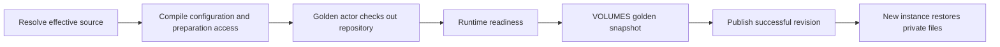

# Prepared repository workspaces

`Agent` and `SandboxTemplate` can select an initial Git
repository. Kagent checks it out into `/data/workspace` during golden preparation,
before runtime readiness. Substrate captures the checkout in its VOLUMES snapshot;
new instances receive independent writable copies before their first turn or
guest operation. Repository setup is independent of the agent's prompt.

Use a full commit SHA for reproducible source contents. A branch or tag is resolved
when the runtime is prepared; newly created Sessions and Sandboxes can therefore
start from an older commit even after the remote ref moves.

```yaml
apiVersion: api.kagent.dev/v1alpha3
kind: Agent
metadata:
  name: repo-coder
spec:
  template:
    ref: {name: coding-agent}
  harnessRef: {name: codex}
  workspace:
    git:
      url: https://github.com/org/repo.git
      ref: 0123456789abcdef0123456789abcdef01234567
      credentialRef: {name: github-git, key: authorization}
```

The same `workspace` value can be placed on `SandboxTemplate.spec`. Omitting it
or setting `workspace: {}` selects an empty initial workspace.

Repository selection belongs to the concrete Agent. AgentTemplates contain reusable
behavior and have no workspace field, including when used inline. Several Agents
can reuse the same template with different repositories. Shared subagents use the
root Agent's disk.

## Commit selection

`ref` is a required full commit SHA, branch, or tag. Preparation fetches that ref and
checks out its commit with detached HEAD, retaining `.git`. New Sessions and
Sandboxes reuse the prepared commit even if the branch moves. There is no fetch
at Session creation, first turn, resume, or checkpoint fork.
Both SHA-1 and SHA-256 Git repositories are supported.

For example, if `main` points to commit A during preparation and later advances
to B, new instances may continue to receive A. A configuration change that causes
another preparation, such as a runtime image update, can resolve `main` to B.
Branch and tag names therefore do not guarantee either the latest commit on every
Session or the same commit across preparations. Pin a full SHA when the exact
source version matters, and update `ref` to a new SHA to select a new version.

Wait for the desired revision to become Ready before creating instances that
require the updated source. A preparation failure leaves the previous successful
revision available. Existing instances, create retries, and forks retain their
pinned revision and saved files.

Failed workspace preparations retry automatically, so transient Git failures and
corrected credentials can recover without changing the source specification.
Kagent conditionally removes only failed, unpublished preparations through
Substrate's cleanup workflow, waiting at least 30 seconds after the failure
before retrying. Published snapshots are retained when credentials rotate.
The checkout timeout is shorter than the wakeup probe, which is shorter than
Substrate's startup RPC deadline. This lets Substrate record a startup failure
before transport cancellation would leave the attempt pending.

## Ownership and lifecycle



The compiler resolves source references; it never clones repositories. The shared
Go runtime initializer stages a checkout on the durable filesystem and publishes
it before readiness. A receipt in `/data/.kagent-workspace/complete.json` records
the source fingerprint and original commit. Interrupted publication can resume;
unexpected nonempty files without a receipt cause initialization to fail.

The receipt sits outside the checkout. Restarts preserve changed HEAD, edited and
untracked files, and deliberate removal of `.git` or the checkout. Runtime tools
may recreate an empty working directory when it is absent, but never repopulate
it from Git. Removing the private initialization metadata is state corruption,
not a refresh mechanism.

Substrate owns golden actors, outbound access before readiness, snapshotting,
and cleanup. Kagent publishes only prepared revisions and explicitly selects the
golden tag when creating an Actor. Missing templates or golden tags fail creation
instead of falling back to a cold boot. Session creation remains suspended/lazy:
it pins the prepared snapshot; disk restoration occurs when the Actor wakes.
No new Session phase, database schema, or activation RPC is needed.

## Credentials and runtime support

HTTPS is the supported transport. `credentialRef` is an optional same-namespace
Secret key containing the complete Authorization header value, for example
`Basic <base64(user:token)>`. The golden sends an inert header which Substrate
replaces at its egress gateway. The real value never enters runtime configuration,
Git remotes, environment variables, or the durable snapshot. Redirects, interactive
credential prompts, inherited Git configuration, and checkout hooks are disabled.

The immutable golden policy combines source access with pinned runtime access
needed during startup. Live `egressPolicyRefs` are excluded. The source grant is
never added to an instance's runtime policy. Grant ongoing Git access separately
when an agent needs to fetch or push after preparation.

The Go ADK, Codex, Claude, and managed Sandbox guest initialize the source before
serving traffic. Native instruction discovery remains the harness's behavior;
source preparation does not turn AGENTS.md or CLAUDE.md into a prompt. Codex's
existing rejection of project `.codex/config.toml` still applies. Python ADK and
BYO runtimes explicitly reject configured sources.

Sandbox tools images must contain Git. The managed guest is mounted as an
executable volume, so Git in the guest image is not available to a different
tools image. Missing Git fails preparation. Checkout has a three-minute timeout
within a four-minute platform wakeup probe. Submodules, LFS downloads, dependency
installation, setup scripts, SSH, and multiple repositories are not implemented.

This requires Substrate v0.7.0-alpha1 or later with boot egress support. The
installer enables `GoldenEgressPolicy` alongside `PerTemplateSnapshotLocation`.
The original commit can be read from the receipt; no public resolved-commit
status is synthesized from a mutable ref.
