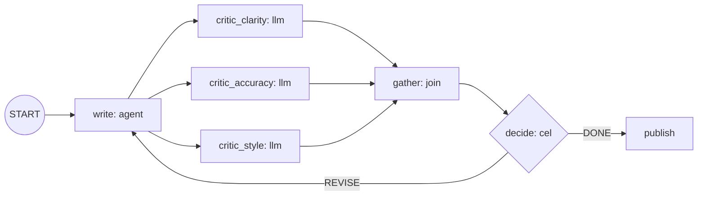

# writer-critics: a bounded revision loop

A Writer drafts a paragraph, three critics review it in parallel, and the Writer
revises until all three approve or 5 turns have passed. Declarative
(`adk.declarative/v0.2`), no Go code.



## How the loop is bounded

`decide` keeps `state.turn`. It takes `DONE` when all three critics approve **or**
`turn >= 5`, so the cycle cannot run more than 5 times whatever the model says.

Two build rules shaped the graph:

- An unconditional cycle is rejected. The loop-back edge is routed (`REVISE`).
- A node with two unconditional incoming edges is rejected. `write` has one
  (`START`); the loop reaches it through the routed edge.

## Test

`go/adk/examples/writercritics` runs the real document through the ADK runner
with a scripted `reviewer` model and checks:

| Scenario | Expected |
|---|---|
| Style approves from draft v3 | stops at turn 3, 3 of 3 approved, 3 writer calls |
| Accuracy never approves | stops at turn 5, 2 of 3 approved, exactly 5 writer calls |
| Everyone approves at once | stops at turn 1, 1 writer call |

```bash
cd go/adk && go test ./examples/writercritics/ -count=1 -v
```

## Status

- Builds and passes the three scenarios above with the scripted model.
- Not deployed and not run against a real model. `manifests.yaml` reuses the
  `pr-review` BYO image as `llm-router` does; that image's model and its
  telemetry are unverified for this workflow.
