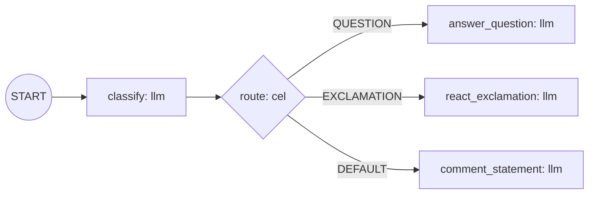

# llm-router: a declarative workflow agent with Langfuse evals

A kagent agent defined entirely in YAML (`adk.declarative/v0.2`), ported from
[adk-go `examples/workflow/routing/llm`](https://github.com/google/adk-go/tree/main/examples/workflow/routing/llm)
with a second LLM stage added on each branch.

- `classify` answers with one word. `route` turns it into a route; anything unexpected takes `DEFAULT`.
- Each branch ends in its own `llm` node. Branches are separate terminals because exclusive routes must not converge on a non-join node.
- No Go code. The harness runs the generic workflow-agent image (`make build-workflow-agent VERSION=dev`), which resolves every model name, here `reviewer`, to the AgentTemplate's ModelConfig.

## Files

| File | Purpose |
|---|---|
| `agent-system.yaml` | The workflow document |
| `manifests.yaml` | Harness, AgentTemplate (`workflowFrom`) and Agent |
| `deploy.sh` | `apply` / `delete` against the k3s cluster over ssh |
| `dataset.jsonl` | 10 labelled messages for an experiment |

## Status

- Runs offline through the workflow-agent runtime in `go test ./adk/examples/declarative/` (from `go/`).
- Not yet deployed or run end to end. See the open items in the lecture notes below.

## Demo steps

1. `./deploy.sh apply`: creates the ConfigMap, Harness, Template and Agent, and waits for `Ready`.
2. Send each line of `dataset.jsonl` to the `llm-router` agent.
3. In Langfuse, open the traces. The `classify` generation holds the label; the branch node holds the reply.
4. Create an LLM-as-judge evaluator on the `classify` observation, scoring the label against the dataset's `expected` value, and run it on the traces from step 2.
5. `./deploy.sh delete` to clean up.
