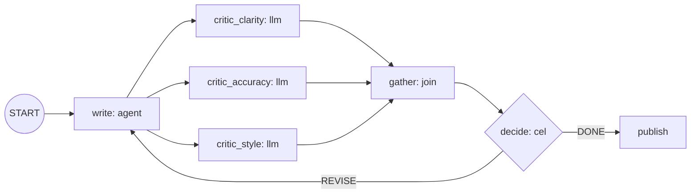

# writer-critics: a bounded revision loop

A Writer drafts a paragraph, three critics review it in parallel, and the Writer
revises until all three approve or 5 turns have passed. Declarative
(`adk.declarative/v0.2`), no Go code.



## How the loop is bounded

`decide` keeps `state.turn`. It takes `DONE` when all three critics approve **or**
`turn >= 5`, so the cycle cannot run more than 5 times whatever the model says.

Two build rules shaped the graph:

- An unconditional cycle is rejected. The loop-back edge is routed (`REVISE`).
- A node with two unconditional incoming edges is rejected. `write` has one
  (`START`); the loop reaches it through the routed edge.

## Run

The workflow runs on the generic workflow-agent image, which has no
workflow-specific code: every model name in the document (`reviewer`) resolves
to the AgentTemplate's ModelConfig.

```bash
make build-workflow-agent VERSION=dev   # from the repository root
./deploy.sh apply
```

In the chat each node's reply is its own message, labelled with its author:
`writer`, `critic_clarity`, `critic_accuracy`, `critic_style`, and
`writer_critics` for the loop itself. Traces go to the exporter the Harness
telemetry configures.

## Test

`go/adk/examples/declarative` runs this document offline through the runtime's
executor and checks that every reply arrives as a separate artifact naming its
author:

```bash
cd go && go test ./adk/examples/declarative/ -count=1 -v
```
