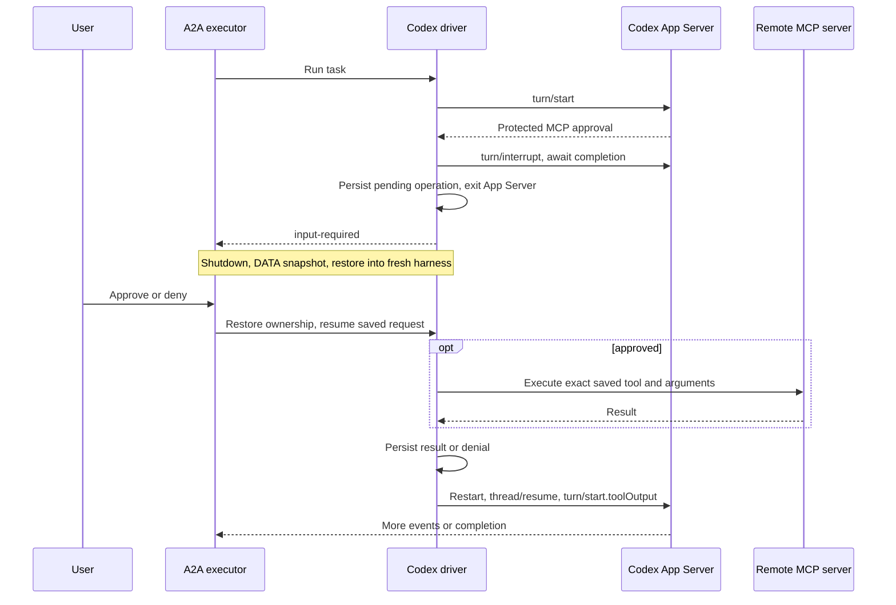

# Codex Harness

The Codex Harness compiles an `api.kagent.dev/v1alpha3` `AgentTemplate` into a
compiler-owned Codex configuration and runs one Codex App Server `0.161.0`
process for each native turn within a public A2A Task. Its native thread and workspace are retained
in the Actor's `DurableDir`.

## Code structure

The controller and Actor share only the versioned config contract. Kubernetes
resolution stays in the controller; Codex App Server behavior stays in this
harness.

| Path                                                                           | Look here for                                                                                                              |
| ------------------------------------------------------------------------------ | -------------------------------------------------------------------------------------------------------------------------- |
| [`../../core/internal/translator/codex`](../../core/internal/translator/codex) | Translating `Harness`, `AgentTemplate`, model, MCP, plugin, and Secret inputs into a runtime revision                      |
| [`config/config.go`](config/config.go)                                         | The versioned JSON contract shared by the compiler and runtime, including defaults and validation                          |
| [`cmd/main.go`](cmd/main.go)                                                   | Actor startup, environment inputs, Codex version validation, continuation-store wiring, and private A2A startup            |
| [`internal/adapter`](internal/adapter)                                         | Materializing `CODEX_HOME`, native TOML, shared agents, skills, and MCP configuration                                      |
| [`internal/driver`](internal/driver)                                           | App Server lifecycle, JSON-RPC framing, event translation, thread resume, cancellation, and process supervision            |
| [`protocol/schema`](protocol/schema)                                           | Generated App Server schema used as a development reference; regenerate it from the pinned CLI rather than hand-editing it |

## Implemented support

- OpenAI through a Secret-backed API key, the Responses API, and an optional
  absolute HTTP(S) base URL.
- Amazon Bedrock through `AWS_BEARER_TOKEN_BEDROCK` in a Secret.
- Streaming text, command and file activity, direct Streamable HTTP MCP (with
  allowed-tools selection), and native Shared agents.
- Per-server MCP tool approval with durable DATA-only restart and cancellation.
- Native ask-user questions in default mode
- Standalone and plugin-selected skills without plugin hooks, commands,
  executables, or implicit plugin MCP servers.
- Native thread resume and bounded cancellation through `turn/interrupt`.

Credentials use [Substrate gateway injection](../../../docs/architecture/credential-injection.md).
AWS IAM keys are rejected because they cannot be injected as outbound HTTP
headers. Harness environment entries accept only literal values.

The adapter deliberately fixes the native sandbox to `danger-full-access`; the
Substrate Actor remains the security boundary. Its granular native approval
policy enables MCP elicitation and rejects command, sandbox, rule, skill, and
`request_permissions` prompts. MCP servers marked for approval prompt through
App Server elicitation, while other MCP servers remain automatically approved.
Account login, ModelConfig `tokenPassthrough`, custom TLS, legacy SSE MCP, Dedicated agents,
checkpoint/fork guarantees, and configurable native policy are not advertised.

Runtime configuration is supplied through `KAGENT_CONFIG_JSON` and
`KAGENT_AGENT_CARD_JSON`. Private A2A is served on port 80 and readiness on
`/readyz` at port 8081.

The adapter disables Codex's default `unbounded_connection_retries` feature.
Substrate DNS policy denials appear as connection failures, so retrying them
indefinitely would leave a task working until canceled. Production runs retain
the provider's native request and stream retry budgets. E2E fixtures opt into
zero retry budgets through an internal test switch while upstream denial
handling still triggers long backoffs. The built-in Bedrock provider rejects
retry-budget overrides and retains its bounded native retries.

## Human-in-the-loop flow

An MCP binding with `requireApproval: true` is emitted with Codex's default
tool approval mode set to `prompt`; other configured MCP servers use `approve`.
The driver exposes only approval requests for the configured protected servers.
Although Codex transports these requests using the `mcpServer/elicitation/request`
App Server method, the external MCP server is not performing MCP elicitation.

The harness interrupts the unanswered native turn, saves the pending operation,
and exits App Server before returning `input-required`. The shared executor
recovers task ownership from this record after DATA restore. Approval executes
the saved MCP call through the harness; denial executes no tool. The harness
resumes the native thread and starts a new turn with `turn/start.toolOutput`.
Ask-user answers similarly start a new turn with the saved questions and answers.



## Key limitations

- **Tool parenting is not retained across DATA suspension.** Resumed invocations
  link to the task's original invocation. Deferred tool spans use the resumed
  invocation and exclude approval wait time. Other tool spans still open when
  input is published are settled as unfinished; previous tool parents are not
  restored. Parenting within an execution segment is retained.
  Reusing a saved MCP result does not create another execution span.

- **Child-thread MCP approvals are declined.** Durable approval continuation
  resumes only the root thread. Shared subagents must return protected tool work
  to the root agent; a child approval callback does not fail the parent task.
- **One pending input at a time.** Only one approval or ask-user request survives
  DATA restore. Concurrent requests are canceled with the interrupted native
  turn; batch approval is not supported.
- **Approval resumes in a new native turn.** The interrupted call stays in Codex
  history, and the harness supplies its result as a standalone named tool output.
  The model may request the operation again after seeing the earlier interruption.
  Journal replay protection does not prevent a newly requested duplicate call.
- **Protected MCP results are serialized as JSON text.** Image and audio results
  are not delivered as equivalent native multimodal tool output.

## Development

The Codex driver launches App Server and communicates with it using JSON-RPC
2.0. To refresh the reference schemas from the pinned Codex CLI, run:

```text
codex app-server generate-json-schema --out go/harness/codex/protocol/schema
```

For protocol details, see the [Codex App Server message
schema](https://learn.chatgpt.com/docs/app-server#message-schema).

## Example

The platform-managed `Harness` selects the Codex runtime, and the `Agent`
references it while defining behavior inline. The referenced ModelConfig and
RemoteMCPServer must already exist in `kagent`. The installed release supplies
the default Harness image. To override it, set `workload.image` to a full
`@sha256:`-pinned reference.

```yaml
apiVersion: api.kagent.dev/v1alpha3
kind: Harness
metadata:
  name: codex
  namespace: kagent
spec:
  codex: {}
  substrate:
    workerPoolRef:
      name: kagent-default
    snapshotPolicy:
      location: gs://ate-snapshots/kagent/
---
apiVersion: api.kagent.dev/v1alpha3
kind: Agent
metadata:
  name: kagent-codex
  namespace: kagent
spec:
  template:
    inline:
      description: test
      modelConfig:
        name: default-model-config # This modelconfig must have openAI.apiFormat set to "responses"
      systemPrompt: |
        Follow the selected skill and use the configured MCP tool.
      tools:
        - mcp:
            server:
              kind: RemoteMCPServer
              name: kagent-tool-server
      plugins:
        - source:
            git:
              url: https://github.com/agentplugins/agent-plugins-example.git
              commit: 5f3f5084a821aefa792e79500dd8f0462ab83473
          skills:
            - migrate-agent-plugin
  harnessRef:
    name: codex
```
